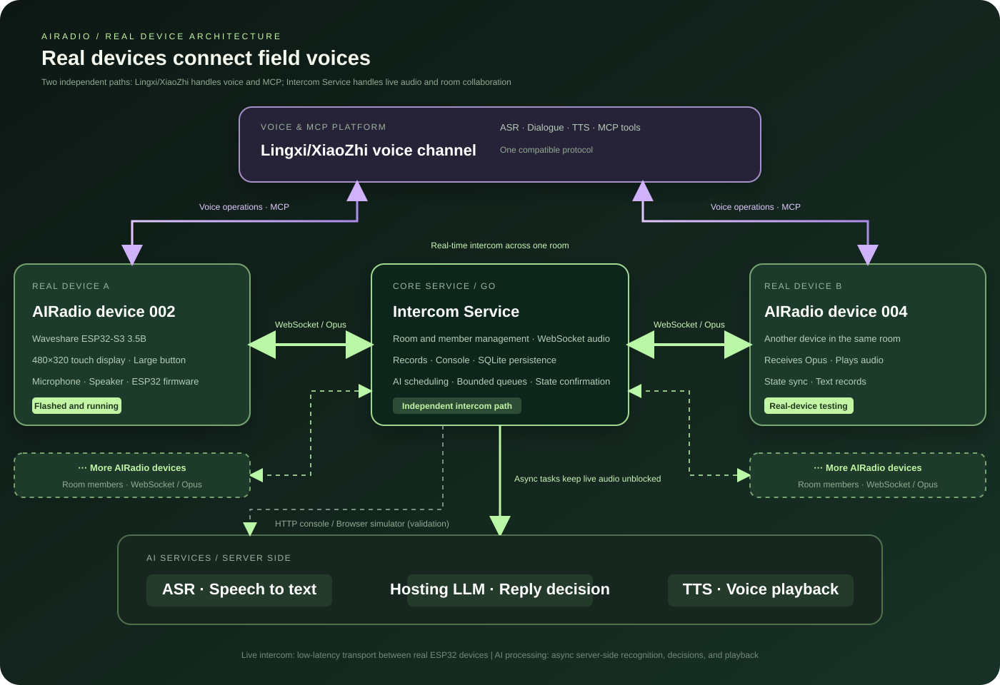
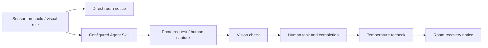

# Lingxi AIRadio: AI Field Collaboration for Communication, Sensing, and Tasks

[](LICENSE)
[](https://github.com/espressif/esp-idf)

[](https://github.com/liuzhe910422/AIRadio/actions/workflows/server-ci.yml)
[](https://github.com/liuzhe910422/AIRadio/actions/workflows/server-ci.yml)

([English](README.md) | [中文](README_zh.md) | [日本語](README_ja.md))

<p align="center"></p>

Lingxi AIRadio is an AI field collaboration solution built on the Lingxi/XiaoZhi voice channel and ESP32 firmware for fleets, logistics parks, warehouses, and temporary teams. It combines real-time half-duplex intercom, voice-controlled rooms, online AI hosting, and recent conversation recall with English translation, images and vision, DHT11 sensing, alerts, task dispatch, and Agent orchestration.

**An AI collaboration terminal for frontline teams:** use a button for instant speech, voice for room and task operations, and photos and sensors for field context. Configured workflows connect anomaly detection, AI assessment, human action, and recovery confirmation.

> **Built on real hardware:** this project is more than a browser or virtual-device demo. The base intercom, rooms, ASR, and hosting features have been flashed onto and tested with a Waveshare ESP32-S3 Touch LCD 3.5B. After flashing the firmware and configuring the intercom service URL, the physical device provides the touch talk button, real-time intercom, voice room operations, ASR records, and AI hosting. The browser simulator is only an auxiliary tool for service and protocol validation.

> **One tap to talk. One sentence to operate. An AI teammate when work gets busy.**

## The problem AIRadio solves

Drivers, warehouse operators, and field workers often have both hands occupied. A conventional radio is fast but still requires separate devices and manual room management. A voice assistant is flexible, but is not the right trigger for an urgent, immediate transmission.

AIRadio gives each action the right interface: **a large button for instant speech, voice for multi-step operations, and AI assistance when a person cannot respond immediately.** Teams can talk quickly, switch groups with less friction, and revisit what was just said.

## Product guides

| Guide | Contents |
|---|---|
| [Business value (Chinese)](README_business.md) | Why the product matters, why customers would pay, and the path from device delivery to ongoing services |
| [AI elements and product experience (Chinese)](README_ai.md) | How AI helps with device operations, missed information, conversation review, and responses while people are busy |

## Key capabilities

- **One-tap real-time intercom**: a large 480×320 touch-screen control starts and ends a transmission. A dedicated WebSocket carries Opus frames to devices in the same room.
- **Voice-controlled collaboration rooms**: Lingxi/XiaoZhi MCP tools can list, create, join, leave, and invite devices to rooms, and enable or disable hosting. A room list can be confirmed on the display.
- **Online AI hosting**: after a human message is transcribed, a hosted device uses recent room context to decide whether to answer. If needed, TTS broadcasts the response. Human speech has priority and can interrupt an automated reply.
- **Conversation recall**: ASR produces short-term transcripts with speaker and duration, and messages can be replayed. Users can ask the assistant to summarize the currently retained conversation.
- **Clear field-ready status**: manual mode uses a blue button and hosting mode uses yellow, while room, speaker, and system events remain visible.
- **Console and simulator**: the Go service includes device and room management, a browser Opus simulator, and ASR, TTS, and hosting-LLM configuration and test APIs.
- **English translation**: switch the intercom UI between Chinese and English. English recipients receive asynchronous translated text and synthesized audio after ASR; original speech is retained and translated audio queues after original playback.
- **Images and vision**: take a photo by voice and share it with the current room; recipients can open thumbnails and full images. Visual alerts and Agent steps use configured prompts for model-assisted assessment.
- **Temperature and humidity**: the Waveshare ESP32-S3 Touch LCD 3.5B reads a DHT11 and displays its readings; server alerts can request a board sensor snapshot. Cameras and sensors require suitable hardware.
- **System alerts**: configure temperature/humidity thresholds or visual rules, a capture device, room, and interval. Matches trigger room text and optional TTS, or an Agent workflow.
- **Cross-device tasks**: create scheduled tasks for another device by voice, with queries, reminders, completion, cancellation, and overdue states. People perform and confirm physical work.
- **Alert orchestration Agent**: configured Skill steps connect photo requests, visual checks, human tasks, temperature rechecks, and recovery broadcasts. The console manages Skills and displays runs.

## A field anomaly workflow

The high-temperature Demo follows this path:

**Temperature exceeds threshold → photo task for 001 → person takes a photo by voice → AI checks a red indicator → task dispatched to 002 → person confirms completion → temperature rechecked → recovery broadcast to the room.**

Online hosting assists with conversation replies; the orchestration Agent advances predefined processing steps. An Agent photo task is a request to a person, not an automatic assistant camera-tool call. People take the photo and replace the sensor. Recovery depends on sensor rechecks; a normal visual assessment does not establish temperature recovery.

Product page: [Open the AIRadio home page](http://154.94.238.56/).

## Project video

> **Previous-version demo:** this video has not yet been updated. It mainly shows the earlier intercom, room management, conversation recall, and AI hosting features. It does not cover the subsequently added translation, vision, temperature/humidity sensing, alerts, task dispatch, or orchestration Agent. See this README and the linked design documents for current capabilities.

- Direct download: [http://154.94.238.56/video/ready.mp4](http://154.94.238.56/video/ready.mp4)
- The video file is relatively large. Download it before watching for a smoother experience.
- Baidu Netdisk backup: [10月25日(1).mp4](https://pan.baidu.com/s/1T_n8MzPlYifnVEFZb5InGw)
- Extraction code: `hty9`

> The demo site currently uses HTTP. Some browsers may show a privacy or security warning. After confirming the address is `154.94.238.56`, choose the browser option to continue, proceed, or allow the page to open.

## Architecture

<p align="center"></p>

The system has four layers. One important separation is that **AIRadio devices connect directly to the Lingxi voice channel for voice interaction and MCP operations; the Intercom Service handles room audio, membership, and records between devices.**

The system has four layers:

1. **AIRadio devices**: `main/intercom/` manages device identity, rooms, audio coordination, temporary records, and MCP tools. The current product target is Waveshare ESP32-S3 Touch LCD 3.5B with a 480×320 touch UI.
2. **Intercom Service**: `server/` is a Go service for WebSocket audio routing, room and member management, the HTTP console, and optional SQLite persistence. The intercom connection is independent of the Lingxi/XiaoZhi assistant session.
3. **AI services**: ASR transcribes completed speech, TTS plays system announcements and hosted replies, and the Hosting LLM decides whether a hosted device should answer. Bounded asynchronous queues keep AI work away from the real-time audio path.
4. **Lingxi voice channel**: AIRadio devices connect directly to the Lingxi (XiaoZhi) voice channel for natural-language understanding and MCP tool calls. Physical speech remains a large device-button action, so voice operations and intercom can coexist.

The audio path is `microphone → 16 kHz mono Opus → WebSocket → same-room device → jitter buffer → decoded playback`. After a session ends, the server submits it to ASR. Eligible hosted devices then run an LLM decision and TTS response.

The added field workflow uses `server/events.go` for scheduled tasks, `server/alerts.go` for capture, rules, and recovery state, and `server/agent.go` for sequential Skill execution. Images upload over HTTP and are announced over WebSocket; sensor capture and alert controls use the Intercom WebSocket. Translation and visual assessment reuse the configured hosting model service; vision requires image input support. These operations stay outside real-time audio forwarding. The image above describes the base communication architecture; the additional workflow is shown below.



## Current scope

The main target is Waveshare ESP32-S3 Touch LCD 3.5B. Devices retain up to 20 recent records, while temporary audio and text are kept in server memory. Device account binding, multi-organization roles, offline replay, permanent history, and cross-instance routing are not implemented yet. Device and replay endpoints are intended for trusted integration environments. Hosting requires ASR, TTS, and the Hosting LLM to be enabled and the device to remain online.

Rooms currently share a global speaking lock and cannot transmit concurrently. The record limit includes system messages; summaries cover only retained, recognized text. Hosting has no external business tools, long-term memory, or offline answering, and cannot confirm that a business action has been executed. Commercial delivery still requires network, acoustic, hardware, security, and operational validation.

Additional limits: translation currently targets English recipients rather than arbitrary-language simultaneous interpretation. Room images and Agent runs are held in memory and do not survive restarts; events, Skills, and alert configuration/active state can persist with SQLite enabled. The Agent is a fixed-step orchestration Demo without autonomous model planning, full timeout escalation, or restart recovery, and temperature rechecks are bounded. Direct alerts may repeat on successive capture cycles. Demonstrations and partial automated checks do not establish industrial safety or production reliability; sustained operation, weak networks, noise, and concurrent hardware use still require targeted physical-device validation.

## Quick start

### Run the intercom service

```sh
cd server
go run . -listen 127.0.0.1:9200 -db ./data/intercom.db
```

The console is served by the same process. Configure ASR, TTS, and Hosting LLM after login; third-party API keys remain server-side.

Enable features as needed: translation requires ASR, the hosting model, and TTS; visual assessment requires an image-capable model. Photos need a supported camera; wire the DHT11 according to the board documentation. Use the Events, System Alerts, and Agent console tabs for configuration and inspection. Follow the [Agent Demo guide](design/agent-demo.md), with one enabled matching Skill per alert type for the demo.

### Build firmware

ESP-IDF v6.0.1 or newer is required. The `release/v6.1` branch is recommended; ESP-IDF 5.x is unsupported.

```sh
python3 scripts/build.py --list-boards
python3 scripts/build.py waveshare/esp32-s3-touch-lcd-3.5b --name default
```

Use the exact board name printed by `--list-boards`. After flashing the firmware onto the real device, configure the independent `intercom.device_id` and intercom service URL in Wi-Fi advanced settings. The feature set described above runs on the physical ESP32-S3 device; the browser simulator is only for auxiliary service validation.

The recommended real device is the Waveshare ESP32-S3 Touch LCD 3.5B with a 480×320 landscape display. Once flashed and configured, it connects to the Lingxi/XiaoZhi channel for voice operations and to the independent Intercom Service for real-time room audio.

## Documentation

- [Industry landscape and business value: sources, scenarios, costs, and pilot metrics (Chinese)](design/intercom-industry-and-business-value.md)
- [Architecture overview](design/intercom-overview.md)
- [Intercom protocol](design/intercom-protocol.md)
- [ASR and session records](design/intercom-asr-session-chat.md)
- [AI hosting mode](design/intercom-hosting.md)
- [MCP implementation](design/intercom-mcp-implementation.md)
- [480×320 UI](design/intercom-ui-480x320.md)
- [Evaluation guide and design trade-offs](design/evaluation-guide.md)
- [English UI and intercom translation](design/intercom-language-translation.md)
- [Image messages and preview](design/intercom-image-messaging.md)
- [DHT11 temperature and humidity](design/dht11-temperature-humidity.md)
- [Scheduled events and task dispatch](design/events.md)
- [System alerts (see Agent guide for later recovery behavior)](design/system-alerts.md)
- [Alert Agent orchestration and recovery](design/agent-demo.md)

## License

This project is open source under the MIT License. The AIRadio service, device firmware, and product home page continue to evolve together in this repository.
