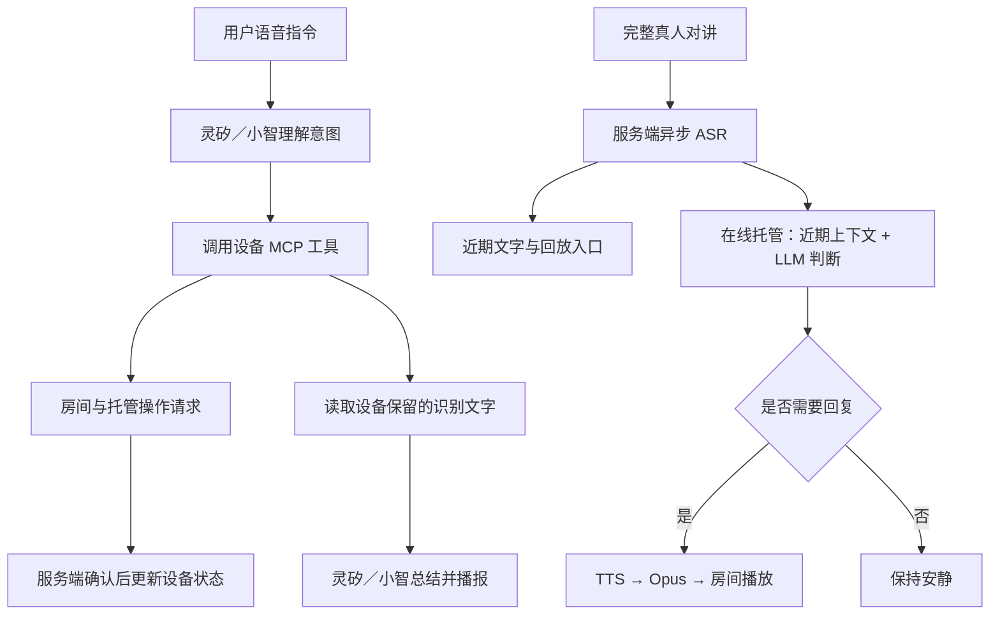

# 灵矽 AIRadio · AI 元素与产品体验

[返回项目首页](README_zh.md) · [English overview](README.md) · [商业价值](README_business.md)

> **让 AI 听懂现场、协助操作、回顾沟通，在需要时开口，在真人发言时让出通道。**

AIRadio 将语音理解、工具调用、语音识别、上下文归纳和语音生成接入真实对讲流程。**项目的 AI 价值在于把“说话、操作、理解、回复”串成可在实机上体验的协作流程。** 用户能通过房间变化、识别文字、托管状态和房间内的语音回复，看到、听到并控制 AI 的参与。

## AI 直接解决哪些现场问题

### 手上忙：把操作意图交给 AI

搬运、装卸和设备操作期间，寻找菜单会打断工作。用户说“有哪些房间”“接受刚才的邀请”“开启托管”，灵矽／小智理解意图并调用设备 MCP 工具，连接到实际房间与模式操作。

**价值在于缩短从“我想做什么”到“设备执行什么”的路径。** 即时发言仍用大按钮；多步骤操作可以通过自然语言表达，用户查看设备确认状态即可。

### 没听清：把短暂声音变为可回顾信息

现场声音转瞬即逝，漏听后常常需要再次呼叫同伴。AIRadio 在真人对讲结束后异步生成文字，并提供原音回放入口。用户可以查看识别结果，也可以回到原始语音核对。

**AI 为即时沟通增加了短期记忆。** 同一条消息既能即时收听，也能事后浏览和重听，为减少重复询问提供直接工具。

### 消息多：让 AI 帮助梳理重点

几轮对讲之后，逐条重听会占用时间。用户说“总结刚才的对讲”，助手通过 MCP 获取当前设备保留的识别文字，再归纳其中的重点与明确待办。

**AI 将多条近期消息整理为更容易掌握的内容。** 总结基于实际保留文字，适合快速回顾当前沟通；需要核实细节时仍可查看记录与回放。

### 回应忙：让 AI 按上下文参与应答

人员忙碌时，可以开启在线托管。另一设备发来真人消息后，Hosting LLM 根据发言内容与近期同房间上下文，判断是否需要简短回复，再通过 TTS 将回复播回房间。

**AI 在实际协作频道中按需参与，帮助分担部分沟通负担。** 默认提示词要求被点名或明确提问时才简短回复；真人开始发言时可打断自动语音。业务数据查询和实际调度仍需要人员处理，或在后续接入授权业务工具。

## 为什么这套 AI 组合有产品价值

四项能力围绕同一个工作现场衔接：**操作靠意图理解，回顾靠语音识别，归纳靠保留内容，应答靠近期上下文。** 用户无需把消息另外整理后再交给模型，系统在既有对讲流程中提供这些能力。

工程实现同时照顾了现场使用：音频转发不等待模型结果，模型可以选择不回复，自动消息不会触发回复循环，切房或退出托管后旧任务失效。这样的协同让 AI 更容易融入真实沟通节奏，也让实机演示具备完整的产品说服力。

## AI 价值：从声音到理解，再到协作

AIRadio 已将几类 AI 能力串入实际终端流程：

| AI 能力 | 用户体验 | 对现场工作的作用 |
|---|---|---|
| **听懂操作意图** | “有哪些房间？”“接受刚才的邀请”“开启托管”，由灵矽／小智理解并调用 MCP 工具 | 减少寻找菜单和记忆操作步骤 |
| **把语音变为信息** | 对讲完成后生成文字，显示发言者与时长，支持原音回放 | 帮助找回漏听内容，减少反复询问 |
| **基于近期内容归纳** | “总结刚才的对讲”，助手读取当前保留的识别文字并播报重点 | 降低重新听取多条消息的负担 |
| **结合上下文辅助应答** | 在线托管设备根据真人消息及近期房间上下文，判断是否需要简短语音回复 | 忙碌时提供有限的沟通辅助 |
| **让人掌握沟通节奏** | 真人发言可打断自动回复，退出托管后恢复手动状态 | 限制自动语音对现场交流的打扰 |

智能链路为 **真人对讲 → ASR → 近期上下文 → LLM 判断 → TTS 房间回复**；语音操作和总结经由独立的灵矽／小智通道完成。ESP32 负责音频、界面和协议协同，识别与大模型由连接的服务提供，属于端云协同架构。

## 产品中看得见、听得见的 AI

建议通过一条连续的实机流程展示产品：

1. **说话即操作**：说“有哪些对讲房间”，设备显示实际房间列表，选择后查看服务端确认的房间状态。
2. **沟通有回顾**：完成一次真人对讲，查看异步生成的文字并点击回放，再请助手总结当前保留的内容。
3. **AI 在线协助**：说“帮我开启托管”，确认后主按钮由蓝色变为黄色；另一设备明确提问时，展示 AI 的上下文判断及按需语音回复。
4. **人随时接管**：真人开始发言，展示自动语音让出通道；退出托管后查看恢复的手动状态。

**AI 的产品辨识度来自真实行为：能理解操作、能回顾沟通、能按需应答，并让用户看清当前模式。** 现有黄色托管按钮、识别文字和“托管回复”标记体现了这些状态。产品主页提供交互示意，实际模型调用与硬件能力以实机链路为准。

## AI 元素由什么组成

| 元素 | 在项目中的职责 | 对应实现或通道 |
|---|---|---|
| **自然语言理解** | 理解查询房间、接受邀请、切换模式等意图 | 灵矽／小智语音通道 |
| **MCP 工具调用** | 将语言意图连接到终端的房间、托管及文字查询操作 | 设备 MCP 工具与 `main/intercom/` |
| **ASR 语音识别** | 真人对讲结束后异步生成文字 | Intercom Service 配置的 ASR 服务 |
| **近期上下文** | 为托管判断提供最近同房间消息，为总结提供设备保留文字 | 服务端短期消息与设备近期记录 |
| **Hosting LLM** | 结合上下文判断是否需要回复，并生成简短内容 | 服务端独立托管模型任务 |
| **助手总结** | 根据工具返回的保留文字归纳重点 | 灵矽／小智模型，不是托管模型任务 |
| **TTS 语音合成** | 将托管回复及系统通知转换为房间可播放的语音 | Intercom Service 配置的 TTS 服务；助手播报走语音通道 |
| **人机协作控制** | 真人优先、退出失效、自动消息不触发循环 | 固件与服务端的确定性控制逻辑 |

回放、状态颜色和真人抢占由普通软件逻辑实现，共同支撑可用的 AI 体验。当前没有在 ESP32 上运行本地大语言模型。

## 三条智能工作链路

实时对讲音频通过独立 WebSocket 转发；ASR、TTS 和托管判断使用异步有界队列，音频转发不等待模型结果。设备直接连接灵矽／小智进行语音操作与总结，Intercom Service 负责房间音频、记录及在线托管。

## 当前能力与演示边界

- **操作确认**：修改类 MCP 工具返回请求排队或发送结果，最终状态以服务端确认事件为准；助手口头回应不等于操作完成。
- **短期记忆**：设备最多保留 20 条记录，包含系统消息；总结仅使用保留的已识别文字，切房或断线会清空。
- **按需托管**：要求设备在线且 ASR、TTS、Hosting LLM 均启用；模型可以选择不回答，不保证每次提问都有回复。
- **真人控制**：真人可抢占自动语音；切房、断线或退出托管后旧任务失效；自动回复不会再次触发托管判断。
- **业务范围**：尚无企业知识库、外部业务工具、长期记忆和离线代答，不承诺实时库存、工单创建或调度已执行。
- **数据边界**：自部署对讲服务不等于全部 AI 处理在本地完成，语音和文字的处理范围取决于所连接的服务。

## 进一步阅读

- [商业价值](README_business.md)：目标客户、行业机会和落地路径。
- [AI 托管设计](design/intercom-hosting.md)：上下文、判断、合成及失效机制。
- [MCP 实现](design/intercom-mcp-implementation.md)：语音操作与会话总结工具。
- [ASR 与会话记录](design/intercom-asr-session-chat.md)：转写与回放。
- [480×320 界面方案](design/intercom-ui-480x320.md)：设备交互与状态呈现。
