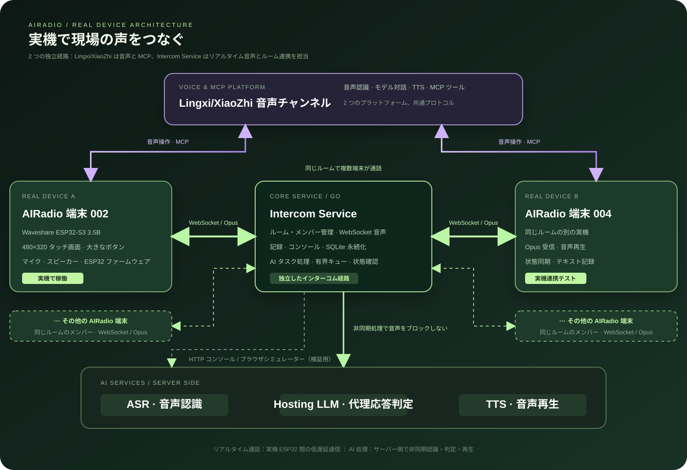
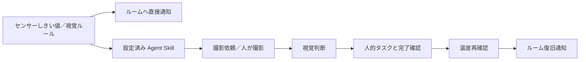

# Lingxi AIRadio：通話・センシング・タスクをつなぐ AI 現場協働端末

（[English](README.md) | [中文](README_zh.md) | 日本語）

<p align="center"></p>

Lingxi AIRadio は、Lingxi/XiaoZhi 音声チャネルと ESP32 ファームウェアを基盤にした AI 現場協働ソリューションです。車両チーム、物流パーク、倉庫、臨時チームに向け、半二重通話、音声ルーム操作、オンライン AI 応答、直近の会話確認に加え、英語翻訳、画像・視覚判断、DHT11 計測、アラート、タスク配信、Agent による処理編成を提供します。

**現場担当者のための AI 協働端末。** ボタンで即時通話し、音声でルームやタスクを操作し、写真とセンサーで現場情報を補います。設定された手順により、異常検知、AI の補助判断、人による作業、復旧確認をつなぎます。

> **実機で動作するプロジェクト：** 本プロジェクトはブラウザや仮想デバイスだけのデモではありません。基本の通話・ルーム・ASR・托管機能は Waveshare ESP32-S3 Touch LCD 3.5B の実機へ ESP32 ファームウェアを書き込み、実機での連携検証を完了しています。ファームウェアを書き込み、インターコムサービス URL を設定すれば、タッチボタン、リアルタイム通話、音声ルーム操作、ASR 記録、AI 托管を実機で利用できます。ブラウザシミュレーターはサービスとプロトコルの補助検証用です。

> **ワンタップで通話。ひとことで操作。忙しい時は AI がサポート。**

## 解決したい課題

ドライバーや倉庫・現場作業員は、運転や搬送で両手がふさがっていることが多くあります。従来の無線機は即時性に優れる一方、ルーム管理には手動操作が必要です。音声アシスタントは柔軟ですが、緊急の発言開始には向きません。

AIRadio は操作ごとに適した入力を使います。**即時発言は大きなボタン、複数手順の操作は音声、すぐに応答できない時は AI** が担当します。チームは素早く話し、少ない操作でグループを切り替え、直前の内容を確認できます。

## 主な機能

- **ワンタップのリアルタイム通話**：480×320 タッチ画面の大きなボタンで開始・終了。専用 WebSocket が Opus フレームを同じルームの端末へ転送します。
- **音声によるルーム管理**：Lingxi/XiaoZhi MCP ツールでルームの一覧、作成、参加、退出、招待の受付、托管の有効・無効を操作できます。ルーム一覧は画面で確認できます。
- **オンライン AI 托管**：人の発言を ASR で認識した後、托管端末が直近の文脈から返信要否を判断します。必要な場合は TTS でルームに返答します。人の発言が優先され、自動音声は中断できます。
- **会話の振り返り**：発言者と時間を含む短期文字起こしを表示し、音声を再生できます。「直前の会話をまとめて」と音声で要約も依頼できます。
- **現場で分かりやすい状態表示**：通常モードは青、托管モードは黄色で表示し、ルーム、発言者、システム通知を画面に明示します。
- **管理コンソールとシミュレーター**：Go サービスで端末・ルーム管理、ブラウザ Opus シミュレーター、ASR・TTS・托管 LLM の設定とテストを提供します。
- **英語翻訳**：中国語・英語の UI を切り替え可能。英語設定の受信端末には ASR 後に英訳と合成音声を非同期配信します。原音を保持し、翻訳音声は原音再生後に再生待ちとなります。
- **画像共有と視覚判断**：音声で撮影し、同じルームへ共有。受信側はサムネイルと拡大画像を表示できます。視覚アラートと Agent は設定したプロンプトで画像を判定します。
- **温湿度計測**：Waveshare ESP32-S3 Touch LCD 3.5B に DHT11 を接続して表示し、サーバーのアラート要求でセンサー値を取得できます。カメラ・センサーには対応ハードウェアが必要です。
- **システムアラート**：温湿度のしきい値または視覚ルール、取得端末、ルーム、周期を設定。条件一致時に文字・任意の TTS 通知、または Agent 処理を行います。
- **端末間タスク配信**：音声で指定端末へ予定付きタスクを作成し、一覧、リマインド、完了、取消、期限超過を扱います。実作業と完了確認は人が行います。
- **アラート編成 Agent**：設定済み Skill の順序に従い、撮影依頼、視覚判断、人的タスク、温度再確認、復旧通知を接続。コンソールで Skill と実行記録を管理します。

## 現場の異常処理フロー

高温処理 Demo の例：

**温度超過 → 001 に撮影タスク → 人が音声で撮影 → AI が赤い表示灯を確認 → 002 に処理タスク → 人が完了を確認 → 温度を再計測 → ルームへ復旧通知。**

オンライン AI 托管は会話への応答を補助し、編成 Agent は事前設定した処理手順を進めます。撮影タスクは人への依頼であり、端末アシスタントの撮影ツールを自動実行しません。撮影とセンサー交換は人が担当します。視覚的に正常という判定だけでは温度の復旧を確認できず、センサーでの再確認が必要です。

製品ページ：[AIRadio ホームページを開く](http://154.94.238.56/)。

## プロジェクト紹介動画

> **旧バージョンのデモ：** この動画は未更新で、以前の通話、ルーム管理、会話の振り返り、AI 托管を中心に紹介しています。その後追加された翻訳、視覚機能、温湿度計測、アラート、タスク配信、編成 Agent は含まれていません。現在の機能は本 README と関連設計資料を参照してください。

- サーバーから直接ダウンロード：[http://154.94.238.56/video/ready.mp4](http://154.94.238.56/video/ready.mp4)
- 動画ファイルは比較的大きいため、ダウンロードしてからの視聴をおすすめします。
- Baidu Netdisk の予備リンク：[10月25日(1).mp4](https://pan.baidu.com/s/1T_n8MzPlYifnVEFZb5InGw)
- 抽出コード：`hty9`

> このデモサイトは現在 HTTP を使用しています。ブラウザによってはプライバシーまたは安全性の警告が表示されます。アドレスが `154.94.238.56` であることを確認し、「続行」「アクセスを許可」などの選択肢を選んでください。

## システム構成

<p align="center"></p>

AIRadio 端末は Intercom Service を経由せず、Lingxi 音声チャネルへ直接接続して音声操作を行います。Intercom Service は端末間のリアルタイム音声、ルーム、記録を担当します。

1. **AIRadio 端末**：`main/intercom/` が端末 ID、ルーム状態、録音・再生、短期記録、MCP ツールを管理します。現在の主な対象は Waveshare ESP32-S3 Touch LCD 3.5B です。
2. **Intercom Service**：`server/` の Go サービスが WebSocket 音声転送、ルーム・メンバー管理、HTTP コンソール、SQLite 永続化を提供します。インターコム接続は Lingxi/XiaoZhi アシスタントのセッションと独立しています。
3. **AI サービス**：ASR は発言を文字に変換し、TTS は通知と托管返答を音声化し、Hosting LLM は返答要否を判断します。有界の非同期キューによりリアルタイム音声をブロックしません。
4. **Lingxi 音声チャネル**：AIRadio 端末が Lingxi（XiaoZhi）音声チャネルへ直接接続し、自然言語の理解と MCP ツール呼び出しを行います。実際の発言操作は大きな端末ボタンで行うため、音声操作とインターコムを並行して使えます。

音声経路は `マイク → 16 kHz モノラル Opus → WebSocket → 同じルームの端末 → ジッタバッファ → デコード再生` です。セッション終了後、サーバーが ASR を非同期実行し、条件を満たす托管端末が LLM 判定と TTS 応答を行います。

追加フローは `server/events.go`（予定タスク）、`server/alerts.go`（取得・条件判定・復旧状態）、`server/agent.go`（Skill の順次実行）で構成されます。画像は HTTP でアップロードし WebSocket で通知、センサー取得とアラート制御は Intercom WebSocket を使います。翻訳と視覚判断は設定済み托管モデルを利用し、視覚機能には画像対応モデルが必要です。これらはリアルタイム音声転送の経路外で処理します。上図は基礎通信構成で、追加フローを下図に示します。



## 現在の範囲

主な対象は Waveshare ESP32-S3 Touch LCD 3.5B です。端末は直近 20 件を保持し、音声と文字はサーバーの一時メモリに保存します。端末アカウント連携、複数組織・ロール分離、オフライン再送、恒久履歴、複数インスタンス間ルーティングは未実装です。端末および再生 API は信頼できる連携環境を前提とします。托管には ASR、TTS、Hosting LLM の有効化と端末のオンライン状態が必要です。

翻訳は現在英語設定の受信端末が対象で、任意言語の同時通訳ではありません。ルーム画像と Agent 実行状態はメモリ上にあり、再起動では復元されません。SQLite 有効時はイベント、Skill、アラート設定・活動状態を保存できます。Agent は固定手順の Demo で、自律的なモデル計画、完全なタイムアウト対応、再起動からの実行再開は未実装です。温度再確認の回数には上限があり、直接通知は周期ごとに繰り返される場合があります。デモや一部の自動検証は産業安全・本番信頼性の保証ではなく、長時間稼働、弱いネットワーク、騒音、ハードウェアの並行動作は実機での追加検証が必要です。

## クイックスタート

### インターコムサービスを実行

```sh
cd server
go run . -listen 127.0.0.1:9200 -db ./data/intercom.db
```

コンソールは同じプロセスから提供されます。ログイン後に ASR、TTS、托管 LLM を設定してください。第三者 API キーはサーバー側だけに保存されます。

必要な機能を個別に設定してください。翻訳には ASR、托管モデル、TTS、視覚判断には画像対応モデルが必要です。撮影には対応カメラ、温湿度計測にはボード資料に沿った DHT11 の配線が必要です。コンソールのイベント管理・システムアラート・Agent タブを使用し、[Agent Demo ガイド](design/agent-demo.md) に従って、各アラート種別に一致する有効 Skill を一つ設定してください。

### ファームウェアをビルド

ESP-IDF v6.0.1 以降が必要です。`release/v6.1` ブランチを推奨し、ESP-IDF 5.x はサポートしません。

```sh
python3 scripts/build.py --list-boards
python3 scripts/build.py waveshare/esp32-s3-touch-lcd-3.5b --name default
```

ボード名は `--list-boards` の出力に合わせてください。実機へファームウェアを書き込んだ後、Wi-Fi 詳細設定で `intercom.device_id` とインターコムサービス URL を設定します。上記の機能は ESP32-S3 実機で動作し、ブラウザシミュレーターは補助的なサービス検証用です。

推奨する実機は 480×320 横画面の Waveshare ESP32-S3 Touch LCD 3.5B です。書き込みと設定が完了すると、Lingxi/XiaoZhi チャネルで音声操作を行い、独立した Intercom Service で同じルームの音声を実際に中継します。

## ドキュメント

- [アーキテクチャ概要](design/intercom-overview.md)
- [インターコムプロトコル](design/intercom-protocol.md)
- [ASR とセッション記録](design/intercom-asr-session-chat.md)
- [AI 托管モード](design/intercom-hosting.md)
- [MCP 実装](design/intercom-mcp-implementation.md)
- [480×320 UI](design/intercom-ui-480x320.md)
- [評価ガイドと設計上の判断](design/evaluation-guide.md)
- [英語 UI と通話翻訳](design/intercom-language-translation.md)
- [画像メッセージとプレビュー](design/intercom-image-messaging.md)
- [DHT11 温湿度センサー](design/dht11-temperature-humidity.md)
- [予定イベントとタスク配信](design/events.md)
- [システムアラート（後続の復旧動作は Agent ガイド参照）](design/system-alerts.md)
- [アラート Agent と復旧フロー](design/agent-demo.md)

## ライセンス

本プロジェクトは MIT License で公開しています。AIRadio サービス、端末ファームウェア、製品ホームページはこのリポジトリで継続的に進化しています。
