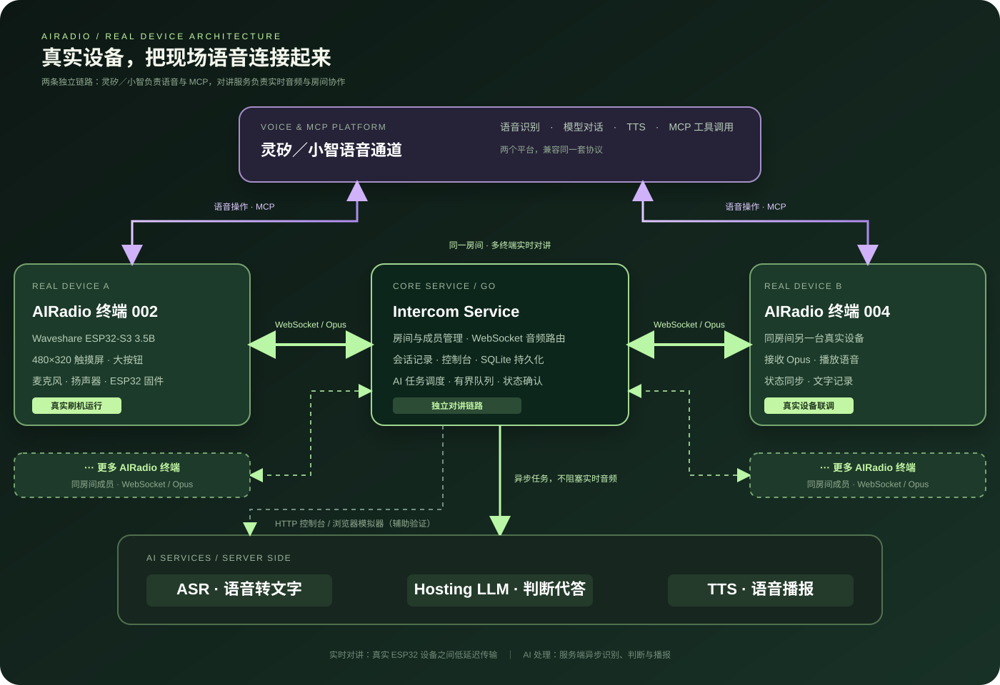
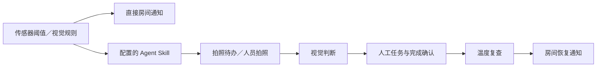

# 灵矽 AIRadio：连接沟通、感知与任务处理的 AI 现场协作终端

（[English](README.md) | 中文 | [日本語](README_ja.md)）

<p align="center"></p>

灵矽 AIRadio 是基于灵矽／小智语音通道与 ESP32 固件构建的 AI 现场协作方案，面向车队、物流园区、仓储和临时协作团队。在实时半双工对讲、语音房间管理、在线托管和近期回顾之外，现已加入英文翻译、图片与视觉判断、DHT11 温湿度采集、告警、任务派发及 Agent 编排。

**产品定位：面向一线人员的 AI 协作终端。** 用按钮即时沟通，用语音组织人员与任务，用照片和传感器补充现场信息；异常发生后，按配置流程衔接 AI 判断、人工处理和恢复确认。

> **真实硬件实现：** 本项目不是只运行在网页或虚拟设备上的演示。基础对讲、房间、ASR 与托管功能已在 Waveshare ESP32-S3 Touch LCD 3.5B 真机上刷入 ESP32 固件并完成实机联调；刷入固件、配置对讲服务地址后，即可使用触摸大按钮、实时对讲、语音房间管理、ASR 记录和 AI 托管功能。浏览器模拟器仅用于辅助服务端和协议验证。

> **一键开讲，一语操控，忙时 AI 搭把手。**

## 为什么做 AIRadio

司机、仓储人员和现场作业人员经常双手忙于驾驶、搬运或操作设备。传统对讲机擅长即时通话，却需要额外设备和人工管理；纯语音助手又不适合需要立刻发言的场景。

AIRadio 的交互分工很明确：**即时发言用大按钮，复杂操作用语音，重复或无人响应的沟通交给 AI 协助。** 用户可以快速说完、快速切组，也能回看刚才发生的沟通。

## 专题介绍

| 文档 | 阅读内容 |
|---|---|
| [商业价值](README_business.md) | 为什么值得做、客户为什么付费，以及从终端交付到持续服务的商业逻辑 |
| [AI 元素与产品体验](README_ai.md) | AI 如何解决操作繁琐、信息漏听、消息梳理与忙时应答问题 |

## 核心亮点

- **一键实时对讲**：480×320 触摸屏上的大按钮，点击开始、再次点击结束；独立 WebSocket 逐帧传输 Opus，同房间设备实时接收。
- **语音管理协作空间**：通过灵矽／小智 MCP 语音工具查询、创建、加入、退出房间，接受最近邀请，开启或关闭托管；语音查询后可在屏幕上确认房间。
- **AI 在线托管**：真人语音完成识别后，托管设备结合近期同房间消息判断是否需要回复，并通过 TTS 在房间播报；真人发言优先，自动回复可被打断。
- **对讲记录可回顾**：ASR 异步生成文字，设备显示发言者与时长并支持回放；可以让助手总结当前保留的近期对讲内容。
- **状态清晰、适合现场**：普通模式使用蓝色按钮，托管模式使用黄色按钮；房间、发言者和系统通知在屏幕上明确呈现。
- **控制台与模拟器**：Go 服务提供设备总览、房间管理、浏览器 Opus 模拟器，以及 ASR、TTS、托管 LLM 配置和测试入口。
- **英文翻译**：支持中文／英文界面切换；保留原始对讲，英文接收设备在 ASR 后异步获得英文译文和合成音频，翻译音频等待原始音频播放完成后排队播放。
- **图片与视觉**：语音拍照后将图片广播到当前房间，成员可查看缩略图和大图；视觉告警与 Agent 可按配置提示词调用视觉模型辅助判断。
- **温湿度感知**：Waveshare ESP32-S3 Touch LCD 3.5B 接入 DHT11，界面显示温湿度；服务端告警可请求读取板级传感器快照。摄像头、传感器均依赖实际硬件支持。
- **系统告警**：控制台配置温度／湿度阈值或视觉规则、采集设备、目标房间和周期，命中后直接发送房间文字与可选 TTS，或交由 Agent 处理。
- **跨设备任务派发**：通过语音创建指定设备的定时待办，支持查询、提醒、完成、取消和逾期状态；现场动作由人员执行并确认。
- **告警编排 Agent**：按配置的 Skill 步骤串联拍照待办、视觉判断、人工任务、温度复查和恢复广播，控制台可管理 Skill 并查看运行记录。

## 一条现场异常处理流程

以高温处理 Demo 为例：

**温度超限 → 向 001 派发拍照待办 → 人员语音拍照 → AI 检查红色指示灯 → 向 002 派发处理任务 → 人员确认完成 → 复查温度 → 房间广播恢复。**

在线托管负责结合对话辅助应答；编排 Agent 负责按预设步骤推进处理流程。Agent 拍照步骤发送的是待办，不会自动调用设备助手拍照；实际拍照和传感器更换由人员参与。温度恢复以传感器复查结果为准，视觉模型判断正常不等于温度已恢复。

产品展示主页：[打开 AIRadio 主页](http://154.94.238.56/)。

## 项目介绍视频

> **上一版本演示：** 本视频尚未更新，主要展示此前的对讲、房间管理、记录回顾与 AI 托管，未覆盖后续新增的翻译、视觉、温湿度、告警、任务派发及编排 Agent。当前能力请以本文说明和相关设计文档为准。

- 服务器直链下载：[http://154.94.238.56/video/ready.mp4](http://154.94.238.56/video/ready.mp4)
- 视频文件较大，建议先下载后观看。
- 百度网盘备用地址：[10月25日(1).mp4](https://pan.baidu.com/s/1T_n8MzPlYifnVEFZb5InGw)
- 提取码：`hty9`

> 该演示站点当前使用 HTTP。部分浏览器可能显示隐私或“不安全”提醒，请在确认地址为 `154.94.238.56` 后手动选择“继续访问”“仍要继续”或允许打开。

## 系统架构

<p align="center"></p>

系统分为四层。需要特别说明的是：**AIRadio 终端直接通过灵矽语音通道完成语音交互和 MCP 操作，不经过 Intercom Service；Intercom Service 负责设备之间的实时对讲、房间和记录。**

系统分为四层：

1. **AIRadio 终端**：`main/intercom/` 管理设备 ID、房间状态、录音与播放协调、临时记录和 MCP 工具；Waveshare ESP32-S3 Touch LCD 3.5B 提供当前的 480×320 触摸界面。
2. **Intercom Service**：`server/` 使用 Go 提供 WebSocket 音频转发、房间与成员管理、HTTP 控制台和 SQLite 持久化。实时对讲与灵矽／小智助手通道相互独立。
3. **AI 服务**：ASR 将完整语音转为文字，TTS 播放系统通知与托管回复，Hosting LLM 判断托管设备是否需要代答。AI 任务使用独立有界队列，避免阻塞实时音频。
4. **灵矽语音通道**：AIRadio 终端直接连接灵矽（小智）语音通道，由它负责自然语言理解和 MCP 工具调用；设备发言仍由大按钮触发，语音操作与对讲连接可以并行存在。

音频路径为：`麦克风 → 16 kHz 单声道 Opus → WebSocket → 同房间设备 → 抖动缓冲 → 解码播放`。对讲结束后，服务端异步提交 ASR；符合条件的托管设备再经过 LLM 判断和 TTS 合成回复。

新增现场处理链路由 `server/events.go`（定时事件）、`server/alerts.go`（采集、规则判断与恢复状态）、`server/agent.go`（Skill 顺序编排）协作完成。图片通过 HTTP 上传、经 WebSocket 广播；传感器采集与告警控制走 Intercom WebSocket。翻译和视觉判断复用配置的托管模型服务，视觉功能要求模型支持图片输入；这些工作不进入实时音频转发路径。上图展示基础通信架构，新增流程见下图。



## 当前实现边界

当前主要适配 Waveshare ESP32-S3 Touch LCD 3.5B。设备最多保留 20 条近期记录，服务端使用内存缓存保存临时音频与文字。当前版本仍不包含设备绑定账号、多组织角色隔离、离线补播、永久聊天历史和跨实例路由；设备连接及回放接口适合可信网络联调环境。托管模式要求 ASR、TTS 和托管 LLM 均已启用，且设备保持在线。

当前不同房间共享全局发言权，不能同时发言。近期记录上限包含系统消息；总结只覆盖保留的已识别文字。托管没有外部业务工具、长期记忆或离线代答，不能代表人员承诺业务操作已完成。正式行业交付仍需验证网络、噪声环境、硬件可靠性、安全与运维能力。

新增功能也有明确边界：当前翻译面向英文接收设备，不能表述为任意语言的同声传译；图片消息与 Agent 运行状态保存在内存，服务重启后不恢复。事件、Skill 和告警配置／活动状态可在启用 SQLite 时持久化。当前 Agent 为固定步骤编排 Demo，不具备模型自主规划、完整超时升级或重启续跑能力；温度复查次数有限。直接告警可能随周期重复通知，不能据此承诺完整去重或工业安全保障。新增功能有演示与部分自动化验证记录，连续运行、弱网、噪声和硬件并行稳定性仍需专项实机验证。

## 快速开始

### 运行对讲服务

```sh
cd server
go run . -listen 127.0.0.1:9200 -db ./data/intercom.db
```

服务端控制台默认由同一进程提供。首次使用请在控制台配置 ASR、TTS 和托管 LLM；第三方 API Key 只保存在服务端配置中。

新增功能按需配置：翻译需要 ASR、托管模型和 TTS；视觉判断需要支持图片输入的模型。拍照需支持的摄像头，温湿度需按板卡文档接入 DHT11。通过控制台“事件管理”“系统告警”“Agent”配置或查看任务与流程；建议先按 [Agent 演示指南](design/agent-demo.md) 配置单个告警类型对应一个启用 Skill。

### 构建固件

项目要求 ESP-IDF v6.0.1 或更高版本，推荐 `release/v6.1` 分支；不支持 ESP-IDF 5.x。使用仓库统一构建入口：

```sh
python3 scripts/build.py --list-boards
python3 scripts/build.py waveshare/esp32-s3-touch-lcd-3.5b --name default
```

具体板卡名称以 `--list-boards` 输出为准。刷入后，在 Wi-Fi 高级设置中配置独立的 `intercom.device_id` 与对讲服务地址。

当前推荐的真实设备是 Waveshare ESP32-S3 Touch LCD 3.5B（480×320 横屏）。完成固件烧录和网络配置后，设备即可连接灵矽／小智通道进行语音操作，并通过独立 Intercom Service 与同房间设备实时对讲。

## 文档索引

- [对讲行业现状与商业价值调研（来源、竞争路线、场景、成本及试点指标）](design/intercom-industry-and-business-value.md)
- [AI 对讲总体设计](design/intercom-overview.md)
- [对讲协议](design/intercom-protocol.md)
- [ASR 与会话记录](design/intercom-asr-session-chat.md)
- [AI 托管模式](design/intercom-hosting.md)
- [MCP 工具实现](design/intercom-mcp-implementation.md)
- [480×320 界面方案](design/intercom-ui-480x320.md)
- [项目评审说明与设计取舍](design/evaluation-guide.md)
- [英文界面与对讲翻译](design/intercom-language-translation.md)
- [图片消息与预览](design/intercom-image-messaging.md)
- [DHT11 温湿度传感器](design/dht11-temperature-humidity.md)
- [定时事件与任务派发](design/events.md)
- [系统告警（后续恢复行为以 Agent 文档为准）](design/system-alerts.md)
- [告警 Agent 编排与恢复流程](design/agent-demo.md)

## 开源许可

本项目基于 MIT License 开源。AIRadio 的行业对讲服务、设备固件和产品主页均在本仓库中持续演进。提交代码前请遵循仓库代码风格与 `AGENTS.md` 中的架构约束。
