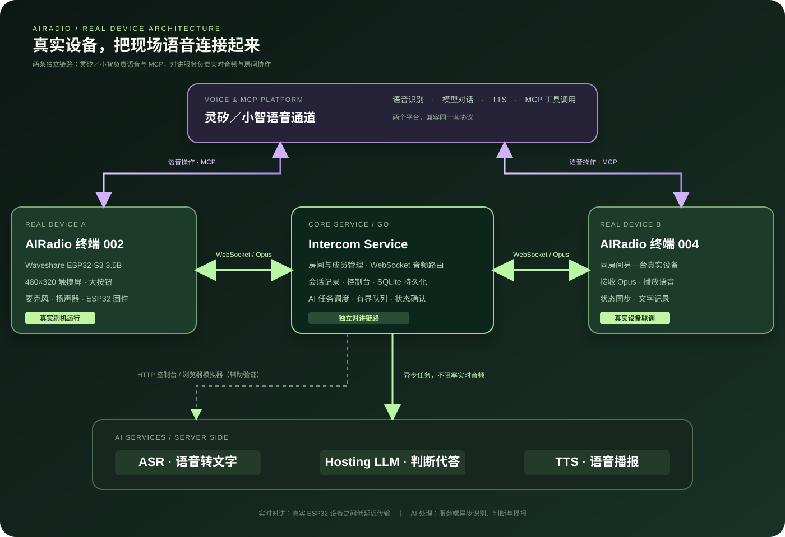

# 灵矽 AIRadio：面向行业现场的 AI 对讲终端

（[English](README.md) | 中文 | [日本語](README_ja.md)）

<p align="center"></p>

灵矽 AIRadio 是基于小智语音交互与 ESP32 固件构建的行业对讲方案，面向车队、物流园区、仓储和临时协作现场。它把实时半双工对讲、语音房间管理、AI 在线托管和近期消息回顾放到同一条工作链路中。

> **一键开讲，一语操控，忙时 AI 搭把手。**

## 为什么做 AIRadio

司机、仓储人员和现场作业人员经常双手忙于驾驶、搬运或操作设备。传统对讲机擅长即时通话，却需要额外设备和人工管理；纯语音助手又不适合需要立刻发言的场景。

AIRadio 的交互分工很明确：**即时发言用大按钮，复杂操作用语音，重复或无人响应的沟通交给 AI 协助。** 用户可以快速说完、快速切组，也能回看刚才发生的沟通。

## 核心亮点

- **一键实时对讲**：480×320 触摸屏上的大按钮，点击开始、再次点击结束；独立 WebSocket 逐帧传输 Opus，同房间设备实时接收。
- **语音管理协作空间**：通过小智 MCP 语音工具查询、创建、加入、退出房间，接受最近邀请，开启或关闭托管；语音查询后可在屏幕上确认房间。
- **AI 在线托管**：真人语音完成识别后，托管设备结合近期同房间消息判断是否需要回复，并通过 TTS 在房间播报；真人发言优先，自动回复可被打断。
- **对讲记录可回顾**：ASR 异步生成文字，设备显示发言者与时长并支持回放；可以让助手总结当前保留的近期对讲内容。
- **状态清晰、适合现场**：普通模式使用蓝色按钮，托管模式使用黄色按钮；房间、发言者和系统通知在屏幕上明确呈现。
- **控制台与模拟器**：Go 服务提供设备总览、房间管理、浏览器 Opus 模拟器，以及 ASR、TTS、托管 LLM 配置和测试入口。

产品展示主页：[打开 AIRadio 主页](http://154.94.238.56/)。

## 项目介绍视频

- 服务器直链下载：[http://154.94.238.56/video/ready.mp4](http://154.94.238.56/video/ready.mp4)
- 视频文件较大，建议先下载后观看。
- 百度网盘备用地址：[10月25日(1).mp4](https://pan.baidu.com/s/1T_n8MzPlYifnVEFZb5InGw)
- 提取码：`hty9`

> 该演示站点当前使用 HTTP。部分浏览器可能显示隐私或“不安全”提醒，请在确认地址为 `154.94.238.56` 后手动选择“继续访问”“仍要继续”或允许打开。

## 系统架构

<p align="center"></p>

系统分为四层。需要特别说明的是：**AIRadio 终端直接通过灵矽语音通道完成语音交互和 MCP 操作，不经过 Intercom Service；Intercom Service 负责设备之间的实时对讲、房间和记录。**

系统分为四层：

1. **AIRadio 终端**：`main/intercom/` 管理设备 ID、房间状态、录音与播放协调、临时记录和 MCP 工具；Waveshare ESP32-S3 Touch LCD 3.5B 提供当前的 480×320 触摸界面。
2. **Intercom Service**：`server/` 使用 Go 提供 WebSocket 音频转发、房间与成员管理、HTTP 控制台和 SQLite 持久化。实时对讲与小智助手通道相互独立。
3. **AI 服务**：ASR 将完整语音转为文字，TTS 播放系统通知与托管回复，Hosting LLM 判断托管设备是否需要代答。AI 任务使用独立有界队列，避免阻塞实时音频。
4. **灵矽语音通道**：AIRadio 终端直接连接灵矽（小智）语音通道，由它负责自然语言理解和 MCP 工具调用；设备发言仍由大按钮触发，语音操作与对讲连接可以并行存在。

音频路径为：`麦克风 → 16 kHz 单声道 Opus → WebSocket → 同房间设备 → 抖动缓冲 → 解码播放`。对讲结束后，服务端异步提交 ASR；符合条件的托管设备再经过 LLM 判断和 TTS 合成回复。

## 当前实现边界

当前主要适配 Waveshare ESP32-S3 Touch LCD 3.5B。设备最多保留 20 条近期记录，服务端使用内存缓存保存临时音频与文字。当前版本仍不包含设备绑定账号、多组织角色隔离、离线补播、永久聊天历史和跨实例路由；设备连接及回放接口适合可信网络联调环境。托管模式要求 ASR、TTS 和托管 LLM 均已启用，且设备保持在线。

## 快速开始

### 运行对讲服务

```sh
cd server
go run . -listen 127.0.0.1:9200 -db ./data/intercom.db
```

服务端控制台默认由同一进程提供。首次使用请在控制台配置 ASR、TTS 和托管 LLM；第三方 API Key 只保存在服务端配置中。

### 构建固件

项目要求 ESP-IDF v6.0.1 或更高版本，推荐 `release/v6.1` 分支；不支持 ESP-IDF 5.x。使用仓库统一构建入口：

```sh
python3 scripts/build.py --list-boards
python3 scripts/build.py waveshare/esp32-s3-touch-lcd-3.5b --name default
```

具体板卡名称以 `--list-boards` 输出为准。刷入后，在 Wi-Fi 高级设置中配置独立的 `intercom.device_id` 与对讲服务地址。

## 文档索引

- [AI 对讲总体设计](design/intercom-overview.md)
- [对讲协议](design/intercom-protocol.md)
- [ASR 与会话记录](design/intercom-asr-session-chat.md)
- [AI 托管模式](design/intercom-hosting.md)
- [MCP 工具实现](design/intercom-mcp-implementation.md)
- [480×320 界面方案](design/intercom-ui-480x320.md)

## 开源许可

本项目基于 MIT License 开源。AIRadio 的行业对讲服务、设备固件和产品主页均在本仓库中持续演进。提交代码前请遵循仓库代码风格与 `AGENTS.md` 中的架构约束。
