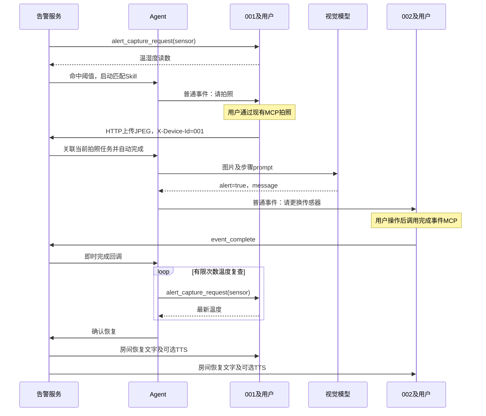

# Agent 告警任务编排：设计、实现与演示指南

状态：按本分支当前代码整理，核对日期 2026-11-01。本功能定位为固定步骤编排 Demo；模型负责视觉判断，服务端按 Skill 中的顺序推进任务。本文描述代码当前行为，并区分自动化验证与仍需实机确认的部分。

关联文档：[系统告警](system-alerts.md)、[事件任务](events.md)、[总体设计](intercom-overview.md)、[MCP 实现](intercom-mcp-implementation.md)、[对讲协议](intercom-protocol.md)。本分支新增行为以本文及代码为准，旧文档中“没有恢复状态”等描述对应此前实现。

## 1. 目标与范围

把温湿度或视觉告警与设备任务串联，完成以下演示：

1. 服务端从设备001读取温度，判断高于配置阈值。
2. 根据告警处理方式启动 Agent。
3. Agent 给001创建“拍摄设备1状态照片”的普通事件任务。
4. 用户通过设备现有拍照 MCP 拍照，设备上传图片。
5. 服务端把001在等待期间上传的第一张图片归属拍照任务，并自动完成任务。
6. Agent 使用 Skill 的视觉提示词判断红色指示灯是否亮起。
7. 判断异常后，给002创建“更换设备001传感器”的人工任务。
8. 用户完成操作，通过现有完成事件 MCP 提交完成。
9. 服务端收到完成回调，Agent 立即开始多次温度复查。
10. 确认恢复后向目标房间广播恢复消息，结束对应运行与未完成任务。

本次只修改 Go 服务端、内置管理页面及文档，复用固件已有拍照、图片上传、事件显示和完成事件 MCP。服务端发来的任务是通知和待办，不会自动让小智模型调用拍照 MCP；演示时需要用户发出拍照语音指令。

## 2. 分层与模块职责

| 模块 | 本分支职责 |
| --- | --- |
| `server/alerts.go` | 周期采集、阈值判断、直接通知/Agent 分流、活动告警状态、恢复广播、采集日志 |
| `server/agent.go` | Skill 数据、顺序执行器、拍照任务关联、事件完成回调等待、温度复查、恢复取消 |
| `server/events.go` | 复用现有设备事件存储、文字通知与 TTS、完成及取消状态 |
| `server/api.go` | Skill 管理 API、运行查询、图片上传关联、告警保存后立即复查 |
| `server/main.go` | 初始化 Agent；设备完成/取消事件后调用 Agent 回调 |
| `server/asr.go` | 告警消息允许发送给未声明聊天能力的房间设备，普通聊天保留能力校验 |
| `server/web/index.html` | Agent Tab、Skill 编辑删除、运行列表、告警处理方式、统一 Tab 可见性 |
| `server/agent_flow_test.go` | 拍照关联、人工完成回调、恢复取消和恢复通知去重测试 |

Agent 运行与设备助手会话相互独立。服务端任务下发走 Intercom WebSocket；用户语音理解、工具选择仍由灵矽/小智通道负责。

## 3. 主流程



## 4. 告警配置与 Skill 匹配

告警页面保留温度、湿度、视觉和告警记录子页。处理方式支持：

| 值 | 页面名称 | 命中后的行为 |
| --- | --- | --- |
| `direct` | 直接通知 | 向配置房间广播告警文字，按 TTS 开关排队播报 |
| `agent` | Agent 处理 | 保存告警记录，启动匹配 Skill；不发送同一次命中的直接文字/TTS |

未配置或非 `agent` 的处理方式在保存/加载时归一为 `direct`。

Agent 页面以“适用告警类型”下拉框编辑 `trigger`：`temperature`、`humidity`、`vision`。告警页面不再要求手写 Skill ID。

当前执行器选择第一个启用且匹配的 Skill；底层使用 map，多个启用 Skill 匹配同一类型时顺序不确定。演示配置应确保每种类型只有一个启用 Skill。后端仍兼容旧 `agent_skill_id`，其匹配采用与类型匹配的或关系，不代表明确的优先级。没有匹配 Skill 时当前不会回退为直接通知。

同一告警存在 `running`、`waiting_image`、`waiting_task` 等活动运行时，不创建第二个运行。运行完成或失败后，如果温度仍异常，后续周期允许重新启动。直接通知仍可能在每次采集命中时广播。

## 5. Skill 格式与完整示例

Skill 是 JSON 配置，不是可执行脚本，也不读取文件系统中的 `SKILL.md`。管理页面分别编辑 ID、名称、适用类型、启用状态和步骤数组；步骤字段仍为 JSON 文本编辑。

```json
{
  "id": "high_temperature",
  "name": "高温处理",
  "enabled": true,
  "trigger": "temperature",
  "steps": [
    {
      "id": "capture",
      "action": "capture_image",
      "device_id": "001",
      "content": "请拍摄设备1的状态照片，调用拍照工具上传图片"
    },
    {
      "id": "analyze",
      "action": "vision_check",
      "prompt": "检查设备1的红色指示灯是否亮起。只要红色指示灯亮起就返回alert=true，否则返回alert=false；message简要说明判断依据。"
    },
    {
      "id": "replace",
      "action": "create_task",
      "device_id": "002",
      "content": "请更换设备001的传感器"
    },
    {
      "id": "check",
      "action": "check_temperature",
      "device_id": "001",
      "attempts": 3,
      "interval_seconds": 10
    },
    {
      "id": "done",
      "action": "broadcast",
      "content": "告警已恢复正常"
    }
  ]
}
```

默认 Skill 使用001拍照、002处理、最多3次复查、间隔10秒。可改为60秒等更符合实际降温速度的配置。演示中的“设备1”是待观察对象，001/002是对讲终端身份；文字和真实硬件安排需要保持一致。

### 5.1 步骤动作

| action | 输入 | 当前行为 |
| --- | --- | --- |
| `capture_image` | `device_id`、可选`content` | 给设备派发拍照事件，等待其下一张上传图片；缺少设备ID时使用告警采集设备 |
| `vision_check` | `prompt` | 分析前一步图片；`alert=true`继续，`false`结束本次运行 |
| `create_task` | `device_id`、`content` | 派发人工事件，等待完成或取消回调；缺少设备ID时使用告警采集设备 |
| `check_temperature` | `device_id`、`attempts`、`interval_seconds` | 首次立即读取温度，仍异常时按间隔重试；读取最新保存的阈值 |
| `broadcast` | `content` | 当前实现为恢复收尾：结束告警及对应任务，向房间发送恢复通知 |

`broadcast` 当前不是任意消息广播动作：只有该规则存在 active 状态时才发送，并立即结束流程。步骤按数组顺序执行，不支持跳转、并行、模板变量或任意条件表达式。

### 5.2 视觉提示词

Agent 的 `vision_check.prompt` 与独立视觉告警的 `alertRule.prompt` 分开。Agent 复用托管 LLM 的 URL、模型和密钥，响应约定为：

```json
{"alert": true, "message": "设备1红色指示灯亮起"}
```

启动加载时，已有 Skill 中缺少 prompt 的视觉步骤会填充默认红灯检测提示词；用户保存后持久化。运行中临时保存一个空 prompt 仍可能使用视觉适配器的通用默认提示词，因此应明确填写判断标准。

泛化的“是否存在需要告警的情况”会让模型自行判断红灯是否危险，容易得到不一致结果。Demo 应明确“红灯亮起就是异常”。模型返回 false 只结束本次视觉流程，不代表温度恢复，不会据此发送温度恢复广播。当前视觉适配器失败也可能返回 false，页面状态不能当作经过人工确认的安全结论。

## 6. 拍照任务与图片关联

服务端维护：

```text
设备ID → {事件ID、Agent运行ID、等待图片通道}
```

派发任务前先建立映射，防止快速上传时丢失关联。现有固件上传 JPEG 到 `POST /api/intercom/images`，已带 `X-Device-Id` 请求头，因此不增加 task_id 或修改设备协议。

图片校验并写入服务端图片缓存后，上传处理器根据设备ID查找当前任务：

1. 无任务：保留普通上传行为。
2. 有任务：删除等待映射，把事件设为 `completed`。
3. 通知设备“拍照任务已完成”。
4. 把图片URL交给等待的 Agent，继续视觉判断。

第一张图片完成任务后，后续图片不再属于该任务。其它设备上传不会完成001的拍照任务。该机制依赖设备自报ID，沿用当前可信内网演示的身份语义。

同一设备同时只演示一个拍照任务；当前没有完整并发任务仲裁，不应让多个不同告警同时占用001。关联只在内存中，重启后不会恢复。

## 7. 人工任务与即时回调

人工任务复用 `event_state`、`event_notification` 和现有 `self.events.list`、`self.events.complete` MCP。完成工具按事件列表序号操作；本地缺少对应序号时，按现有工具约定先查询事件。

Agent 在派发前注册 `event_id → 完成通道`。设备通过 WebSocket 发送 `event_complete` 后：

1. 服务端校验并更新事件状态。
2. 返回完成确认，发送事件完成通知。
3. 调用 `agent.eventCompleted(event_id, status)`。
4. 唤醒对应运行，继续下一步，不轮询事件列表。

设备取消与管理端取消也会通知 Agent；当前人工步骤收到取消后进入 failed。为避免旧定时事件调度器在任务刚派发后将其标为逾期，Agent 创建的事件暂设为24小时后到期；这属于 Demo 复用策略。

## 8. 告警状态、阈值调整与恢复

服务端在 alerts 存储项增加 `active` 映射，记录哪些规则已经实际命中过。历史记录与活动状态不同；升级前已有的命中记录不会自动迁移为 active，升级后须发生一次实际命中。

高温告警条件为 `temperature > temperature_above`，恢复为不再命中；只有上限时等价于 `temperature <= temperature_above`。低温和湿度采用对应方向。没有收到对应有效读数时不宣告恢复。

保存启用中的告警会异步立即发起一次采集，不等待下一周期。例如：

```text
阈值20℃，读数24℃，active=true
→ 页面把阈值改为30℃并保存
→ 立即请求001最新温度
→ 读数24℃，不命中新阈值
→ 清除active，取消对应流程和待办
→ 房间广播一次恢复消息
```

保存成功不代表设备已经响应；广播须等待有效采集。关闭告警本身不会立即宣告恢复。周期调度仍每10秒检查哪些规则到期，复查与周期采集可能同时出现。

恢复收尾会取消关联 Agent 上下文、将运行标为 `recovered`、取消未完成事件并通知目标设备、清除等待图片关联。恢复文字默认使用“告警名称 + 告警已恢复正常”；Skill 的最后一步可提供自定义文字。TTS 遵从该告警的 TTS 开关及全局配置。active 已清除时不再次广播。

## 9. 管理页面

Agent Tab 支持：

- 加载 Skill 列表；点击编辑回填所有字段和步骤 JSON。
- 保存新 Skill 或覆盖同ID的 Skill。
- 删除指定 Skill。
- 手动刷新运行记录，显示运行ID、Skill、状态、当前步骤和消息。

列表编辑/删除采用 `data-agent-edit`、`data-agent-delete` 和事件委托，避免内联 onclick 的引号破坏按钮。顶部 Tab 由 `selectTab()` 统一控制面板显隐，修复 Agent 与事件管理等页面同时显示的问题。

当前没有独立的新建/重置表单按钮；修改ID并保存会创建新配置，原配置仍存在。删除 Skill 不会停止已经启动的运行，运行继续使用启动时的步骤数据。编辑正在运行的 Skill 同样不会改变该次执行的步骤。

## 10. HTTP 接口

均需要现有 `airadio_admin` Cookie 登录会话。

| 方法与路径 | 行为 |
| --- | --- |
| `GET /api/agent/skills` | 返回 Skill 数组 |
| `POST /api/agent/skills` 或 `PUT /api/agent/skills` | 保存完整 Skill，同ID覆盖 |
| `DELETE /api/agent/skills?id=high_temperature` | 删除指定 Skill，成功返回 `{"ok":true}` |
| `GET /api/agent/runs` | 返回内存中的运行记录数组 |
| `PUT /api/alerts` | 保存告警，增加 `handling` 字段；启用时立即采集复查 |

Skill 保存请求上限64KiB，当前校验非空ID、名称和非空步骤。删除缺少ID返回400，不存在返回404。当前没有独立单条 Skill 查询接口，编辑使用列表数据；列表顺序不保证固定。页面下拉限制触发类型，但后端尚未做完整动作、参数、触发类型校验。

运行字段：`id`、`skill_id`、`alert_id`、`status`、`current_step`、`message`、`created_at`、`updated_at`。`current_step` 从0开始，页面显示时加1。常见状态为 running、waiting_image、waiting_task、completed、failed、recovered；温度复查期间目前仍显示 running。

## 11. 持久化与重启

| 数据 | 位置 | 重启行为 |
| --- | --- | --- |
| Skill | SQLite `service_config` 的 `agent_skills` 项 | 重新加载 |
| 告警配置、记录、active | `service_config` 的 `alerts` 项 | 重新加载，命中记录最多500条 |
| Agent Run、完成等待、拍照关联 | 服务端内存 | 不恢复 |
| Agent派发的普通事件 | 当前 eventStore | 本分支未增加事件持久化，不能据Skill持久化推断待办可恢复 |
| 上传图片URL及JPEG缓存 | 服务端内存 | URL重启失效；Agent拍照不自动沿用独立视觉告警的落盘步骤 |

没有加载到任何 Skill 时启动会补默认 high_temperature；因此删除全部 Skill 后重启，默认项会重新出现。无 `-db` 模式下配置也仅存在内存。

## 12. 启动与演示操作

```sh
cd /Users/liuzhe/new-work/AIRadio/server
go run . -listen 127.0.0.1:9200 -db ./data/intercom.db
```

1. 确认001、002在线且加入目标房间，001有摄像头与有效温湿度读数。
2. 配置可用的托管视觉模型；需要语音时启用TTS。
3. Agent页编辑 high_temperature，确认设备ID、任务内容、视觉prompt和复查间隔。
4. 温度页配置采集设备001、目标房间、触发阈值，选择Agent处理并保存。
5. 001收到任务后，通过语音调用现有拍照工具上传图片。
6. 确认任务自动完成；模型判断红灯亮后，002应收到更换任务。
7. 002用户完成操作，通过完成事件MCP提交；观察立即温度复查。
8. 可以把阈值调整到当前温度以上以演示恢复，等待最新采集后检查两台设备恢复文字及可选播报。

代码更新后须重启 `go run` 进程；管理页面刷新以加载最新页面。构建、自动化通过不代表摄像头、MCP语音触发和真实扬声器均已验收。

## 13. 日志与排查

| 日志关键字 | 含义 |
| --- | --- |
| `alert configuration loaded` | 启动时加载的类型、handling、启用状态 |
| `alert configuration saved` | 保存配置的类型、处理方式 |
| `alert capture request` | 目标设备、request_id、sensor/image类型 |
| `alert capture response` | 设备回报的ok、温湿度、image_url、error；type可能为空，按request_id关联 |
| `alert capture timeout` / `send failed` | 采集超时或排队失败 |
| `alert decision` | 温湿度命中及实际handling |
| `agent capture completed` | 哪台设备的图片完成了哪个事件 |
| `alert vllm prompt/response/decision` | 实际视觉提示词、上游响应、最终判断 |
| `alert broadcast` | 目标房间、候选接收人数、文字 |
| `alert recovered` | 规则进入恢复收尾 |
| `TTS started/completed` | 合成与音频包准备情况 |

广播 recipients 是选出的在线房间设备数，不是设备实际播放确认；HTTP音频GET、TTS合成成功也不保证扬声器播放完成。重复HTTP日志行不能据此推断执行了两次业务操作。

直接告警广播不再受 `chat_enabled` 限制；普通聊天仍保留该能力校验。任务通知沿用现有事件通知行为，语音部分依赖设备聊天能力与TTS配置。

## 14. 验证记录与当前限制

本次实现执行 `go test -race ./...`，最终结果通过。新增测试：

- `TestAgentCaptureUsesDeviceTask`：派发普通事件、错误设备图片不完成任务、正确图片自动完成并推进。
- `TestRecoveryEndsAgentAndNotifiesOnce`：恢复取消上下文和任务、清除图片关联、重复恢复不重复广播。
- `TestAgentHumanCompletionCallback`：人工事件完成回调唤醒后续执行。

测试使用内存设备与事件，不代表真实模型、语音MCP、温度硬件和播放验收。最终版本仍需按第12节完成实机联调，尤其是001拍照上传、002语音完成、多次复查及阈值调整后全房间恢复。

本次未扩展复杂异常重试、跨进程恢复、多设备并发编排、流程版本管理和完整参数验证。视觉判断false与温度恢复分开；等待期间的采集任务可能需要用户操作；多条规则并发共享同一拍照设备尚无完善仲裁。上述均为当前Demo边界。
