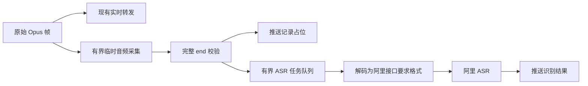

# 对讲 ASR 与会话内聊天记录设计

状态：服务端 ASR、控制台配置 tab、临时音频缓存和消息推送已实现；固件气泡和点击回放待实现。已实现接口见 [intercom-protocol.md](intercom-protocol.md)，固件界面见 [intercom-ui-480x320.md](intercom-ui-480x320.md)。

## 1. 目标与范围

实时对讲与语音识别分别执行。设备发送的 Opus 继续实时转发，ASR 不参与发言权分配、接收准备或音频播放，识别超时和失败不能阻塞对讲。

新增功能：

- AIRadio 对讲控制台增加独立的“ASR 配置”tab，集中维护阿里 ASR 的 URL、Key 等配置。
- 每段完整对讲结束后异步识别，生成当前 session 内的临时聊天记录。
- 固件 480×320 界面右侧滚动显示文字气泡，本机消息靠右，远端消息靠左。
- 点击气泡回放完整音频；长文字只显示前一部分。
- 不提供跨 session 历史查询，不将聊天消息和录音长期存入 SQLite。

本阶段不实现边说边出字幕、全文展开、离线补播、跨设备同步历史或永久录音检索。

## 2. Session 定义

聊天 session 指设备本次对讲 WebSocket 连接期间、当前活动房间中的消息视图，与小智语音助手的 session_id 无关。

- hello 注册成功：开始新的聊天 session。
- 对讲 WebSocket 断开或设备重启：清空本机记录；重连不补拉旧记录。
- 成功切换房间：清空当前记录，开始新房间视图。
- 小智会话连接或断开：不清空对讲记录。
- 只有消息开始时就在相应房间的参与设备可获得该段记录；未参与的设备不补播。

服务端为连接分配随机、不跨重连复用的 chat_session_id，并维护连接/房间视图代次。ASR 完成时校验代次，避免断线或切房后收到旧识别结果。

## 3. 服务端数据流



音频暂存、解码和外部网络请求不在服务器全局发言锁内执行。转发路径仅进行有界的非阻塞投递；录音或 ASR 资源不足时跳过记录生成并记录原因，实时对讲继续运行。

仅接收完整 end 且帧数一致的语音生成记录；abort、异常断线和上传失败丢弃临时内容，不当作完整消息。

### 临时音频

单独维护会话音频缓存，不复用 `-save-wav` 的调试录音作为回放存储。关闭调试 WAV 后聊天回放仍应可用。

保存原始 Opus 包及包边界，供固件回放；根据阿里接口需要，在工作任务中生成 PCM/WAV 等识别输入。阿里请求格式由适配器负责，不能把原始 Opus 包直接声明为 WAV。

### 建议资源上限

| 资源 | 初始上限 | 达到上限时 |
|---|---|---|
| 每段语音 | 沿用 30 秒产品上限、500 帧、512 KiB | 沿用对讲结束/拒绝规则 |
| 每设备当前记录 | 最近 20 条 | 后续新消息入库时移除最早记录的会话引用；无引用记录进入清理 |
| 全局临时音频缓存 | 32 MiB | 淘汰最早记录，回放返回已失效 |
| 临时音频最长寿命 | 30 分钟 | 删除音频，气泡标记不可回放 |
| ASR 排队任务 | 16 项 | 新记录标记识别不可用 |
| ASR 并发 | 2 个 | 其它任务排队 |
| 单次 ASR 等待 | 30 秒 | 标记失败，不无限重试 |

这些是实现初值，不是已有配置。新消息生成时会清理失效 session 引用；所有引用失效的记录可提前清理。服务重启后清空全部临时记录和音频。聊天 SQLite 表和长期录音目录均不在本阶段范围内。

## 4. 控制台 ASR 配置 tab

在现有控制台增加标签页：

```text
[对讲控制台] [ASR 配置]

ASR 配置
启用识别       [开关]
服务提供商     阿里云
接口类型       [具体适配器]
ASR URL        [输入框]
API Key        [密码输入框]
模型           [适配器需要时显示]
AppKey 等      [适配器需要时显示]

[保存配置] [测试识别]
最近测试结果：成功 / 失败原因
```

URL、Key 等统一在此 tab 保存和查看配置状态，避免散落在房间或设备卡片中。配置区域沿用管理员 HTTP 登录。

阿里 ASR 产品存在不同接口：API Key、AccessKey/Token、AppKey、模型名称、请求格式可能不同。实现前需确认使用的具体产品和官方接口；控制台按适配器显示必要字段，不把所有阿里接口假定为同一种协议。不将密钥写入 URL 查询参数或普通日志。

### 保存与展示

- ASR 配置属于服务设置，可持久化到服务端 SQLite；聊天记录仍只临时保存。
- Key 只在服务端使用，不通过设备协议下发，不返回给浏览器。
- 查询配置只返回 key_configured 等状态和掩码。
- 密钥输入留空表示保持已有 Key；清除 Key 需要单独明确动作。
- 保存时校验 URL scheme、必填字段、适配器支持的参数和字段长度。
- 禁用 ASR 后仍保留已生成记录并允许在有效期内回放；新消息可显示语音占位，不提交识别。
- 修改配置使用新快照处理后续任务，正在处理任务沿用提交时快照。
- 配置在内存模式下仅进程内有效；指定 -db 时持久化。密钥存储位置和备份应按服务配置管理。

### 拟新增管理 API

| 接口 | 用途 |
|---|---|
| GET /api/asr/config | 获取非敏感配置和是否已设置密钥 |
| PUT /api/asr/config | 校验并保存配置；不在响应回显密钥 |
| POST /api/asr/test | 使用短测试音频验证鉴权、格式和识别结果 |

测试任务必须有时长/大小上限和超时，不在 HTTP 请求期间持有发言锁。具体字段随阿里适配器确定；当前代码尚未实现这些 API。

## 5. 记录字段与新增事件草案

每条记录至少包含：

| 字段 | 类型 | 含义 |
|---|---|---|
| chat_session_id | string | 接收方当前聊天视图标识 |
| message_id | string | 服务端生成的全局唯一记录 ID，不能仅用客户端自报 ID |
| room_id | string | 音频开始时固定的房间 ID |
| source_id | string | 已注册发送设备 ID |
| created_at | string | 服务端 UTC RFC3339 时间 |
| duration_ms | integer | 按实际音频帧计算的时长 |
| text | string | UTF-8 显示摘要 |
| text_truncated | boolean | 是否因显示上限截断 |
| asr_status | string | pending / completed / failed / disabled |
| audio_available | boolean | 当前是否还可回放 |
| audio_path | string | 同一服务上的相对回放路径，不包含第三方 Key |

沿用对讲 WebSocket 推送，不新开设备消息连接：

```json
{"type":"chat_message","chat_session_id":"view-1","message_id":"msg-abc","room_id":"default","source_id":"002","created_at":"2026-10-24T05:00:00Z","duration_ms":4200,"text":"","text_truncated":false,"asr_status":"pending","audio_available":true,"audio_path":"/api/intercom/messages/msg-abc/audio"}
```

ASR 完成后更新同一气泡：

```json
{"type":"chat_message_update","chat_session_id":"view-1","message_id":"msg-abc","text":"请在东门集合。","text_truncated":false,"asr_status":"completed"}
```

推送范围包含发送者和该段同房间参与接收设备，区别于实时音频不向发送者回放的规则。客户端校验 chat_session_id 和 message_id；重复通知更新已有气泡，不重复追加。消息过期可推送 audio_available:false；断开/切房的设备不再收到该视图的更新。

文字只保留显示摘要，建议最多 80 个 Unicode 字符，超出加省略号并设置 text_truncated。不能按 UTF-8 字节直接截断。完整音频不随文字截断。限制单帧 JSON 大小，避免超出现有固件接收上限。

## 6. 音频回放接口草案

GET /api/intercom/messages/{message_id}/audio 获取临时录音。

当前阶段按联调需求暂不做 token 或参与者鉴权，设备直接 GET 返回的完整 audio_path。连接/房间视图标识仍用于过滤消息推送，不作为音频下载凭据。后续再补回放鉴权。

响应使用有版本和包边界的 Opus 流格式，例如：固定头部包含版本、采样率、声道和 frame_ms，随后每帧为固定字节序长度加原始 Opus 数据。已实现 AIR1 字节格式，详见协议第9节。不能把裸包简单拼接后交给 Opus 解码器。

- 固件分块下载、逐帧解码，使用有界缓冲，不整段加载到 SRAM。
- 缓存失效或消息不存在返回 410。
- 控制台回放解析相同 Opus 包流并复用浏览器解码能力。
- 若需要服务部署在独立 HTTP 基础地址，应明确配置，不能把 ws:// URL 直接当 HTTP 使用。

## 7. 固件右侧聊天气泡

左侧保留设备状态、当前房间、大对讲按钮和小智回复区域。右侧约 300px 宽度用作当前房间对讲记录：

```text
┌──────────────────────────────┐
│ 对讲记录 · 城东车队            │
│ 004  14:20                   │
│ ┌──────────────────────────┐ │
│ │ 请在东门集合。       ▶ 5秒 │ │
│ └──────────────────────────┘ │
│                    我 14:21  │
│        ┌───────────────────┐ │
│        │ 收到。       ▶ 2秒 │ │
│        └───────────────────┘ │
└──────────────────────────────┘
```

- 远端消息左对齐，本机消息右对齐；显示发送者、时间、摘要和时长。
- pending 显示“正在识别…”；failed/disabled 显示“语音消息 · 点击播放”。
- 点击整个文字气泡开始回放；播放中显示状态，再次点击停止。
- 自动滚动仅在用户原本接近底部时执行；向上查看时保留当前位置。
- 保留最近 20 条，删除 LVGL 对象时同步释放事件数据和文字缓存。
- 清空房间视图时取消下载和回放，使用代次标记防止迟到回调访问已释放控件。
- 网络回调只验证并投递应用任务，LVGL 更新遵守显示锁。

## 8. 音频互斥与优先级

优先级：实时对讲 > 聊天回放。回放过程中收到可接受的实时对讲，停止回放并释放下载/播放状态，然后按现有协议接收。

助手、录音、对讲播放和历史回放共用音频服务，不能直接并发写扬声器或重置彼此解码器。由 Application 协调音频所有权：助手忙或本机正在发言时点击气泡提示稍后重试。点击开始对讲时可先停止历史回放，再启动录音。

ASR 仅在服务端处理，不占用 ESP32 的麦克风或编解码任务。

## 9. 实施顺序

1. 确认阿里 ASR 产品、鉴权、音频输入格式和 URL，定义适配器。
2. 控制台增加 ASR 配置 tab、管理 API、密钥掩码和配置持久化。
3. 服务端增加临时消息/音频缓存、独立有界识别任务及清理机制。
4. 增加消息推送、识别更新、音频回放接口（鉴权后续实现）。
5. Web 控制台先验证文字气泡与录音回放。
6. 固件接入右侧消息列表、分页以外的有限滚动和点击回放。
7. 更新正式协议字段、音频流字节格式和运维配置说明。

## 10. 验收与异常场景

- ASR 慢、断网、鉴权失败、队列满时实时对讲仍正常。
- 对讲结束立即出现占位，识别完成后更新原气泡。
- 本机和远端记录均显示正确，长文字按 Unicode 安全截断，仍可播放完整语音。
- 点击回放能听到对应消息；连续点击、快速切房和断线不访问失效 LVGL 对象。
- 对讲实时音频可以打断回放；助手/录音音频互斥正常。
- 切房、重连和服务重启不恢复旧记录，不收到旧 session ASR 更新。
- 音频过期、权限不足、下载中断能显示明确状态。
- Key 在保存响应、设备协议、浏览器日志和服务日志中均不泄露。
- 连续多段对讲验证缓存上限、ASR 并发、设备 SRAM/PSRAM 峰值和分区容量。

实机成功播放与长时间稳定性必须单独验证，服务端测试和固件编译不能替代硬件验收。

## 11. 服务端落地记录

已选用 qwen3-asr-flash，OpenAI 兼容 HTTP chat/completions 内联 Base64 WAV。Go net/http 直接调用，无额外 Python 进程。指定测试录音通过 Go 适配器实际识别为“喂喂。”。

服务端已实现 ASR 配置 tab、配置 API/SQLite 保存、测试上传、独立识别队列、临时 Opus 音频缓存、无需 token 的临时音频回放及消息事件。准确字段和 AIR1 字节格式见协议第9节。新增事件需 hello 的 chat_enabled=true，保护旧固件兼容性。

当前范围不包含固件气泡或 Web 消息回放 UI；控制台 tab 可上传 WAV 验证 ASR。过期记录回放返回410，暂未主动推送过期事件。房间关闭仍依据后续消息和服务端当前房间检查撤销旧音频访问。

当前实现更新：音频回放无需 token 校验，直接访问 audio_path；session 标识仅用于消息推送范围控制。

## 12. 运行与存储位置

```sh
cd server
go run . -listen 127.0.0.1:9200 -db ./data/intercom.db \
  -public-base-url http://111.62.241.117:9200
```

127.0.0.1 只监听本机；上述公网地址需要已有代理/转发。没有代理时应使用 -listen 0.0.0.0:9200。public-base-url 只影响返回的 audio_path，不改变监听范围。

- 原始 Opus 包保存在进程内存 server.chat.messages 对应的 chatMessage.packets 中，不生成 .opus 文件。
- 回放 HTTP 请求时临时封装 AIR1 响应，不持久化 AIR1 文件。
- ASR 工作任务将缓存 Opus 解码成16kHz单声道16-bit PCM WAV，通过 Base64 data URL 上传百炼，无需公网录音下载地址。
- server/recordings/*.wav 是已有独立调试录音，受 -save-wav 控制，不是聊天消息缓存。关闭调试录音不影响 ASR。
- service_config SQLite 表保存 ASR 配置；消息、识别文字和原始 Opus 不写入数据库，进程退出后消失。
- 当前不做回放 token 校验。playback_token 字段为兼容保留，下载端不需要使用它。
