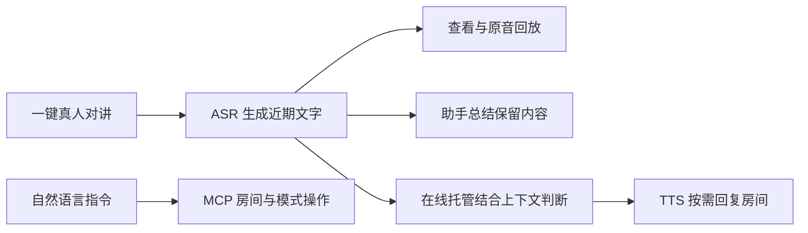

# 对讲行业现状与 AIRadio 商业价值调研

调研日期：2026-10-26。本文结合厂商公开产品资料与 AIRadio 当前代码、设计文档分析行业机会。原厂资料用于确认产品方向，不代表独立性能测评；AIRadio 的市场定位、商业模式和试点建议属于项目分析，尚无付费客户、收入或投资回报数据佐证。

## 1. 行业现状：即时语音正在成为现场 AI 的入口

对讲的核心需求一直是让一线人员迅速找到同伴、同步状态、协调行动。车队、仓储、园区、零售和活动保障等现场，工作人员经常无法持续查看手机，语音仍然是低操作负担的信息入口。产品竞争已从终端和覆盖能力，延伸至组织管理、调度平台及沟通内容的利用。

当前市场呈现多种路线并存的格局，不能把所有对讲需求视为同一个替换市场：

| 路线 | 主要购买价值 | 当前发展与限制 | 对 AIRadio 的启示 |
|---|---|---|---|
| 模拟对讲及 DMR 等数字专网 | 专用终端、即时群呼、可独立规划的无线覆盖 | 数字化和专网产品持续存在；覆盖、频谱、部署及维护条件随方案变化 | 专用终端的确定性交互值得保留；当前 AIRadio 不具备专网直通能力 |
| PoC（Push-to-Talk over Cellular，公网对讲） | 利用蜂窝网络连接分散团队，并集中管理设备和群组 | 海能达已将群呼、调度、定位及数据能力组合为平台产品 [1]；覆盖和体验依赖实际网络 | 网络化对讲和房间管理已经是成熟需求，单纯增加 WebSocket 转发不足以形成差异 |
| 跨终端 PTT 与订阅服务 | 手机、专用终端和调度岗位协同，按用户持续提供服务 | Motorola WAVE PTX 展示了蜂窝 PTT、群组管理和按用户订阅 [2] | 商业收入可从硬件销售延伸至服务、部署和运维，但需要持续可用性支撑 |
| AI 增强的一线协作平台 | 减少漏听、查找信息和重复问答，把沟通转为可利用的信息 | Zello 提供语音转写，并展示企业知识助手与运营洞察 [3][4] | AI 价值应落在具体工作结果；AIRadio 可围绕短期上下文、语音操作和托管形成自己的组合 |

海能达同时保留 DMR 产品线 [5] 和 PoC 产品线 [1]，说明联网方案并未消除专网需求。对 AIRadio 来说，更合适的初始市场是**具备可用 IP 网络、愿意小范围试点的商业协作现场**。当前主要硬件验证对象是 Waveshare ESP32-S3 Touch LCD 3.5B，不能将仓库中其他板卡的蜂窝能力等同于 AIRadio 已完成全国公网移动覆盖验证。

## 2. 可核查的趋势与机会

### 从“卖终端”走向“终端 + 平台 + 服务”

Motorola WAVE PTX 官网同时强调蜂窝通信、实时群组管理及按用户订阅 [2]。海能达 PoC 将终端与 HyTalk 平台、调度和数据能力组合展示 [1]。这说明客户购买的价值可以包含团队组织和持续服务，而不仅是设备本身。

AIRadio 已有终端固件、Go 服务、设备与房间控制台、AI 配置入口和浏览器模拟器，适合构成小规模场景试点的交付起点。后续若提供托管服务，仍需补齐账号与设备归属、组织隔离、计量计费、监控及容量治理。

### 从“听到声音”走向“保留并理解信息”

Zello 的转写产品明确支持浏览语音文字、寻找遗漏信息，并与其消息历史产品结合 [3]。其 AI 页面进一步展示基于企业知识的问答和运营洞察 [4]。行业竞争正在进入沟通内容的理解与利用环节。

AIRadio 已将完整对讲异步转写，支持近期文字、原音回放和通过助手总结当前保留内容。它提供的是**现场短期沟通记忆**，目前没有永久知识库、长期历史搜索、跨班次档案或运营分析报表。

### 从“人工逐项操作”走向“自然语言表达意图”

房间创建、切组和模式切换是协作过程中的操作负担。AIRadio 通过灵矽／小智语音通道理解意图，再调用设备 MCP 工具执行房间与托管操作。这一价值来自自然语言与实际设备控制的衔接，可减少反复寻找菜单的步骤。

实际工具选择依赖语音通道的模型；修改类工具返回排队或发送结果，最终成功仍以服务端状态确认为准。因此演示和销售材料应展示真实状态变化，不能把助手口头答复作为操作成功的唯一证据。

### 从“随时必须有人回答”走向“AI 按上下文协助应答”

AIRadio 在线托管的入口是同房间真人消息。服务端将转写和近期上下文交给 Hosting LLM，模型判断是否需要回复，再由 TTS 将结果播回房间。默认提示词要求仅在被点名或明确提问时简短回复，避免编造事实和承诺未执行的操作。

这为忙碌时的基础沟通辅助提供了产品形态。当前托管没有连接企业库存、订单、运输或工单系统，不能可靠回答实时业务数据，也不能承诺调度已经完成。设备必须在线，真人发言优先，切房、断线和退出托管会使旧任务失效。

## 3. AIRadio 的产品定位与差异

**灵矽 AIRadio：让现场沟通可理解、可回顾、可协助应答的 AI 对讲终端。**

项目将即时对讲、自然语言控制和短期沟通上下文组合在一台实机终端上。它的产品价值可以沿一条完整路径展示：

| 产品价值 | 已实现支撑 | 商业含义 | 当前边界 |
|---|---|---|---|
| 熟悉的一键沟通 | 实机触摸大按钮、半双工 Opus 转发 | 保留一线人员熟悉的即时语音习惯 | 点击开始、再次点击结束；当前服务端采用全局单发言权 |
| 用说话完成协作操作 | 查询、创建、加入、退出房间，接受最近邀请，切换托管 | 有机会减少菜单学习和组队操作时间 | 工具选择依赖模型，修改结果需服务端确认 |
| 对讲内容可回顾 | 异步 ASR、近期文字、回放、总结工具 | 有机会减少重复询问和漏听后的反复确认 | 设备最多 20 条记录，含系统消息；总结仅基于保留的已识别文字 |
| AI 按需参与房间 | 上下文判断、TTS 回复、真人抢占、自动消息防循环 | 忙碌时提供有限的应答辅助 | 在线、短上下文，无外部业务工具和离线代答 |
| 便于定制交付 | MIT 开源、ESP32 固件、Go 服务与控制台 | 可围绕设备形态、行业集成和部署服务开展项目 | 产品化质量、运维和交付成本需要验证 |

ESP32 承担采集、编码、播放、界面及协议协同；语音识别与大模型能力由所连接的服务提供。当前架构是端云协同，不是在 ESP32 上本地运行大语言模型。部署自己的 Intercom Service 也不代表语音和文字全部留在本地，数据边界取决于配置的语音及 AI 服务。

AIRadio 的差异在于开源工程、专用终端交互和 AI 协作链路的组合，而非宣称行业首次具备转写或 AI 问答。可持续竞争力需要在噪声下的识别、应答准确性、真人抢占、使用成本和现场交付中积累证据。

## 4. 目标场景与采购价值

以下为优先验证的场景假设，尚不代表已有行业客户或完成行业认证。

| 场景 | 典型沟通问题 | AIRadio 可展示的作用 | 潜在采购方 | 试点观察指标 |
|---|---|---|---|---|
| 仓库、物流园区 | 作业中不方便查菜单，信息漏听后重复确认 | 语音切房、查看近期转写、回放与总结 | 园区运营方、仓储负责人、集成商 | 切组耗时、重复询问次数、关键信息找回时间 |
| 有网络覆盖的车队驻点、装卸区 | 调度与现场人员临时组队，人员忙碌时回复中断 | 临时房间、邀请通报、在线托管辅助 | 车队和物流运营方 | 组队成功率、消息响应时间、托管有效回复率 |
| 商业物业、会展和活动协作 | 临时人员多、菜单学习成本高、沟通信息易遗忘 | 大按钮操作、语音管理房间、近期沟通回顾 | 物业及活动服务商 | 上手时间、操作成功率、重复确认次数 |
| 智能硬件及行业方案开发 | 从录放音到房间、模型和 UI 的整合工作量大 | 可运行的终端与服务作为定制起点 | 硬件厂商、方案商、系统集成商 | 集成工时、首次部署时间、每设备支持成本 |

移动车队还需要额外验证蜂窝接入、切网、弱网、供电及安装条件。消防、公安、矿井等任务关键或特殊环境，不应以当前项目替代所需的专业通信、可靠性与设备认证方案。

## 5. 商业化路径与成本结构

可以从一个有明确痛点的现场付费试点开始，验证有效后逐步形成以下交付组合。下面均为商业模式建议，当前项目没有内置计费或订单系统。

| 交付组合 | 可收费的价值 | 商业化前置条件 |
|---|---|---|
| 终端与实施服务 | 设备选型、固件配置、部署、培训及售后 | 可靠性、声学、续航、硬件供应和质保验证 |
| 对讲平台运维服务 | 持续维护房间、设备和 AI 配置，提供可用性支持 | 公网安全、组织隔离、监控、备份和容量验证 |
| AI 增值服务 | 按约定提供转写、总结、托管及模型运维 | 用量计量、质量评估、费用上限及服务协议 |
| 行业定制与集成 | 专用 UI、企业知识、WMS/TMS/工单接口 | 新增知识检索和授权工具执行，验证业务数据及操作正确性 |

建议分别核算设备和平台成本：

- **设备交付贡献**＝设备收入 − 物料与组装 − 测试物流 − 实施及质保支持成本。
- **月度服务贡献**＝月度服务收入 − ASR 用量成本 − LLM 用量成本 − TTS 用量成本 − 服务器与网络 − 运维支持成本。
- **客户净收益估算**＝节省工时 × 客户认可的工时价值 ＋ 有证据的差错损失减少额 − 新增设备摊销和服务费用。

不能将节省时间直接等同于减少人员编制，也不能假定 ESP32 硬件成本必然使整套方案比手机或成熟对讲产品更便宜。终端、AI 调用、现场网络和售后共同决定总拥有成本。

ASR 在真人对讲结束后触发；托管还会引入 LLM 判断和按需 TTS。长对话、多个托管设备和频繁播报会影响成本，应在试点中统计每小时语音量、判断次数、有效回复数和单位设备 AI 费用。当前控制台配置和有界队列不等于已经实现商业用量账单。

## 6. 产品如何呈现 AI 价值

AI 元素应通过用户看得见、能验证的动作呈现。建议演示一条连续工作流程，而不是单独展示模型聊天：

| 演示动作 | 用户看到或听到的结果 | 展现的 AI 能力 | 真实性要求 |
|---|---|---|---|
| 说“有哪些对讲房间？” | 助手查询，设备出现可选房间列表 | 语音理解与工具调用 | 使用实际返回的房间；加入成功看状态确认 |
| 真人完成一次对讲 | 近期记录出现识别文字，可点击回放 | ASR 把声音变为可浏览的信息 | 转写是异步结果，不包装成逐字实时字幕 |
| 说“总结刚才的对讲” | 助手播报保留文字中的重点 | 基于现场上下文的归纳 | 说明截断、淘汰或识别缺失；不宣称掌握完整历史 |
| 说“帮我开启托管” | 服务端确认后主按钮变黄，显示托管模式 | 语言意图转换为设备状态 | 先启用 ASR、TTS 和 Hosting LLM，设备保持在线 |
| 另一设备向托管设备明确提问 | 模型按上下文决定是否简短回复，并在房间播放 | 上下文理解、应答判断与语音生成 | 不预设每次必答，不编造库存或已执行的业务动作 |
| 真人开始发言或退出托管 | 自动语音让出通道，确认后恢复手动状态 | 可控制的人机协作 | 展示实际确认与抢占结果 |

现有蓝色手动按钮、黄色托管按钮、转写记录和“托管回复”标记，已提供可见的 AI 状态。后续若增加“正在识别／正在判断／正在合成”等反馈，必须由真实服务状态驱动；这些额外状态不属于当前已实现功能。

产品主页是无需连接后端的交互示意；真正能力应结合实机、控制台和真实服务展示。不能把网页动画当作实际模型调用或性能证据。

## 7. 试点验证与商业化门槛

推荐先在网络条件明确的单个现场，对照记录原有工作方式和 AIRadio 试用表现，再决定是否扩展。以下指标需要实际采集，项目目前没有对应的商业验证数值：

| 验证维度 | 建议指标 | 决策意义 |
|---|---|---|
| 基础通信 | 发言到接收的延迟分布、失败率、连续运行与断线恢复 | AI 功能不能掩盖沟通链路问题 |
| 语音操作 | 房间查询、加入、退出及托管切换的任务成功率、耗时 | 判断是否减少了实际操作负担 |
| 信息回顾 | 关键字段识别正确率、遗漏率、回放找回时间、总结事实错误率 | 判断转写和摘要能否减少重复确认 |
| AI 托管 | 该答时回答的比例、不该答时误答率、事实错误率、真人抢占成功率 | 判断自动介入是否有帮助、是否打扰现场 |
| 使用与经济性 | 活跃设备、各能力使用频次、每设备服务成本、培训与支持工时 | 判断客户是否持续使用，以及服务是否有合理毛利 |

进入规模化商业交付前，应围绕实际合同补齐：设备及组织权限、公网加密与回放访问控制、消息留存和删除策略、容量与故障恢复、噪声及弱网验证、硬件质量和售后保障。当前服务不同房间共享全局发言权，不能将“支持多个房间”宣传为“多房间同时发言”。

知识库问答、WMS/TMS/工单联动、离线代答、长期检索、自动运营报表和多租户 SaaS 都可作为扩展方向，当前尚未实现。项目当前的优势是已有实机协作链路和清晰的扩展接口，后续商业价值需要通过任务完成率、现场使用和成本证据持续证明。

## 8. 来源与证据范围

以下页面在 2026-10-26 访问并核查正文。没有采用无法核验口径的市场规模、增长率、厂商份额或节省比例；这些产品资料也不能用来推断整个行业的 AI 普及率。

1. [Hytera：PoC Radios / Push-to-Talk over Cellular](https://www.hytera.com/en/product-new/lte-broadband/poc-radios.html)：确认公网对讲、HyTalk 平台、群呼、调度及定位等产品方向。
2. [Motorola Solutions：WAVE PTX](https://www.motorolasolutions.com/en_us/products/command-center-software/broadband-ptt-and-lmr-interoperability/wave.html)：确认蜂窝 PTT、群组管理及按用户订阅方向；实际供应范围和费用以当地厂商条款为准。
3. [Zello：Transcription](https://zello.com/product/features/transcription/)：确认语音转写、文字浏览和消息历史结合；页面所述套餐及测试期状态会变化。
4. [Zello：AI](https://zello.com/product/ai/)：确认企业知识助手及运营洞察的产品方向；不将其能力归为 AIRadio 已实现功能。
5. [Hytera：DMR Two-way Radios](https://www.hytera.com/en/product-new/digital-radio/dmr-two-way-radios.html)：确认专用数字对讲产品线仍在提供。

AIRadio 能力核查依据：[总体设计](intercom-overview.md)、[托管设计](intercom-hosting.md)、[MCP 实现](intercom-mcp-implementation.md)、[评审与设计取舍](evaluation-guide.md)、[服务端说明](../server/README.md)，以及 `server/hosting.go`、`main/intercom/intercom.cc` 的当前实现。既有实机联调记录不等同于本次重新执行硬件测试。
