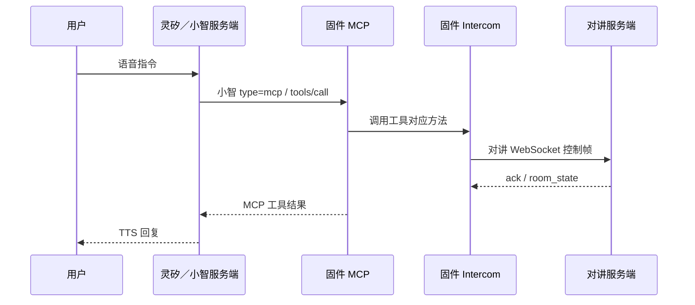

# 对讲 MCP 当前实现说明

本文记录当前代码行为，便于固件、灵矽／小智服务端和对讲服务联调。字段定义参见 [对讲协议](intercom-protocol.md)，房间规则参见 [第二版设计](intercom-v2.md)。

## 1. 职责与两条连接

设备同时维护两条独立链路：

- 灵矽／小智协议通道：语音识别、模型回复、TTS，以及 MCP 工具发现和调用。
- 对讲 WebSocket：设备 hello 注册、房间管理控制帧和实时 Opus 收发。

灵矽／小智服务端负责理解“创建房间”“有哪些对讲群”等语音意图，选择调用设备提供的工具。固件不在本地匹配语音文本，也不把对讲音频发到灵矽／小智通道。



注意：除列表查询外，当前修改房间的工具在请求发送后即返回，MCP 结果可能早于对讲服务端确认。

## 2. 工具注册与可见性

`Application` 启动时依次调用 `McpServer::AddCommonTools()` 和 `AddUserOnlyTools()`。九个对讲工具目前写在 `AddUserOnlyTools()` 函数中，但实际使用的是普通 `AddTool()`，因此默认 `tools/list` 会返回它们。

函数名不等于权限类别。真正使用 `AddUserOnlyTool()` 的管理工具带 `user_only` 标记，默认工具列表会过滤，只有 `withUserTools:true` 才返回。对讲工具不能改回这一类别，否则语音模型可能看不到。

工具发现和调用均走 MCP JSON-RPC：

```json
{"jsonrpc":"2.0","id":10,"method":"tools/list","params":{}}
```

```json
{"jsonrpc":"2.0","id":11,"method":"tools/call","params":{"name":"self.intercom.list_rooms","arguments":{}}}
```

这些报文嵌入灵矽／小智协议的 `type:"mcp"`、`payload` 对象，由 `Application` 转给 `McpServer::ParseMessage()`。工具列表超过单页容量时返回 `nextCursor`，灵矽／小智服务端需要继续获取后续页。

## 3. 已提供的工具

| 工具 | 输入参数 | 实现方法 | 当前返回语义 |
|---|---|---|---|
| `self.intercom.set_hosting` | `enabled` 必填boolean | `SetHosted()` | bool，仅表示请求排队，实际状态以hosting_state为准 |
| `self.intercom.get_hosting` | 无 | `IsHosted()` | bool，当前已确认托管状态 |
| `self.intercom.get_session_transcript` | 无 | `GetSessionTranscript()` | 当前本地会话文字JSON对象，供小智总结 |
| `self.intercom.get_current_room` | 无 | `RoomName()` | 本地缓存的 `room_name` 对象，无实时服务端查询 |
| `self.intercom.list_rooms` | 无 | `ListRooms()` | 实际服务端响应 JSON 字符串，或包含 `ok:false,error` 的 JSON 字符串 |
| `self.intercom.create_room` | `name` 必填字符串；`invite_device_ids` 可选字符串，默认空 | `CreateRoom()` | bool，仅表示请求发送是否成功 |
| `self.intercom.join_room` | `code` 必填字符串 | `JoinRoom()` | bool，仅表示请求发送是否成功 |
| `self.intercom.leave_room` | 无 | `LeaveRoom()` | bool，仅表示请求发送是否成功 |
| `self.intercom.accept_room_invite` | 无参数 | `AcceptInvite()` | 使用最近一次邀请的加入码发送请求；无待处理邀请返回 false |

工具结果通过现有 `McpTool::Call()` / `ReplyResult()` 返回。列表 JSON 是文本内容中的字符串，模型需要读取其中的 `ok`，不能把收到 MCP 成功响应等同于业务成功。

`self.intercom.accept_room_invite` 不接收参数。设备收到 `room_invite` 控制帧后保存最近一次邀请的房间名称、房间 ID和四位加入码；用户明确同意最近邀请时调用该工具，固件自动发送对应 `accept_room_invite`。请求成功发送后清除待处理邀请码，服务端业务确认仍通过 `accept_room_invite_ack`／`room_state` 返回。没有待处理邀请时返回 false；发送失败或服务端拒绝时不应向用户宣称已加入，重新收到新邀请后覆盖旧邀请。该工具不根据用户口述的数字选择历史邀请。

### 当前房间查询

返回示例：

```json
{"room_name":"调度组"}
```

`room_name_` 初始为“默认房间”，收到对讲控制消息中的 `room_name` 后更新。该查询仅反映缓存，不证明当前对讲连接在线；目前也没有返回 `room_id` 或连接状态。

### 房间列表查询

1. `ListRooms()` 检查对讲状态，断线立即返回错误。
2. 生成随机 `request_id`；同一时间只允许一个待完成列表查询。
3. 通过 `QueueText()` 把 `list_rooms` 放进控制队列。
4. 对讲网络任务的 `FlushControl()` 发出请求。
5. 网络回调收到 `list_rooms_ack` 后比较 `request_id`，保存原始响应并唤醒条件变量。
6. 最多等待 5 秒，超时清除请求标识，迟到响应不会匹配后续查询。

3.5B收到有效列表后在应用任务创建15秒倒计时选房弹窗，列表显示房间名称及其后的加入码（范围1000～9999，不使用前导零），默认房间仅显示名称，并高亮当前房间。点击通过现有join_room／leave_room申请切房，等待服务端确认后关闭；支持手动关闭、超时关闭、忙碌提示及断线清理。MCP输入与返回JSON不变，其它板型不显示该弹窗。关闭窗口不撤销已经发送的请求。

失败原因包括：`intercom disconnected`、`room query busy`、`room query timed out`。对讲服务端限制完整响应不超过 8192 字节，固件文本接收也限制 8192 字节。

服务端只返回未关闭的默认房间、开放房间、本机创建的房间，以及邀请列表包含本机的房间。每项包含 `room_id`、`room_name`、`is_default`、`is_current`、`can_join`、`code`；默认房间加入码为空。

### 创建房间

MCP 参数示例：

```json
{"name":"临时调度组","invite_device_ids":"003,004"}
```

MCP 当前仅支持字符串属性，邀请 ID 用英文逗号切分后转换成 WebSocket 数组。设备 ID 保留原有格式；当前解析不会自动去除各 ID 周围空格，调用端应传 `003,004`，避免 `003, 004`。

```json
{"type":"create_room","name":"临时调度组","creator_device_id":"002","invite_device_ids":["003","004"]}
```

服务端使用已注册 WebSocket 身份作为创建者。创建者自动进入新房间；受邀设备不会自动加入。邀请列表为空表示开放加入。当前工具只检查连接和非空名称，不等待 `create_room_ack`，因此小智应说“已发送创建请求”，不能仅凭 true 断言创建成功。

### 加入、退出和接受邀请

```json
{"type":"join_room","code":"1234"}
```

```json
{"type":"leave_room"}
```

```json
{"type":"accept_room_invite","code":"1234"}（由固件自动使用最近邀请发送）
```

`code` 使用四位数字字符串（1000～9999），不使用前导零。退出回默认房间。服务端校验房间有效性、邀请权限等条件；固件当前不等待这些操作的 ack。

按名称切房没有独立工具：可以先查询房间列表，唯一匹配后使用返回的 code 加入；同名时询问用户。默认房间用 `leave_room` 返回。

## 4. 执行线程和资源限制

- 小智网络回调：解析消息并投递工作，不能在这里等待房间查询响应。
- 普通 MCP 工具：经 `Application::Schedule()` 在应用任务执行。
- `self.intercom.list_rooms`：`DoToolCall()` 特殊分派到 `intercom_rooms` FreeRTOS 工作任务（8192 字节栈、优先级 2），执行带超时的条件变量等待；结束后删除任务。
- 对讲网络任务：发送排队控制消息，持续转发音频；不因灵矽／小智会话结束而停用。
- 对讲接收回调：匹配列表请求、唤醒工作任务，并继续处理音频和房间事件。

列表查询互斥锁保护请求 ID 和响应；条件变量等待会释放锁。查询进行中再次调用会返回 busy，不启动第二个实际网络查询。

## 5. MCP 后结束小智对话

当前 `Application` 在收到灵矽／小智 MCP `tools/call` 时记录工具名和调用标记。例外：

```text
self.get_device_status
```

这是服务端自动状态查询，不设置自动结束标记；如果此前已执行其它工具，状态查询也不会取消已有标记。`initialize`、`tools/list` 和 MCP 响应均不算工具调用。

结束条件：

1. 记录到非例外的 `tools/call`。
2. 收到灵矽／小智 TTS `stop`。
3. `AudioService::IsPlaybackIdle()` 确认解码/播放队列及在途音频已完成。
4. 当前仍为 Speaking 且没有被用户打断。

`FinishAssistantReply()` 关闭小智 `Protocol::CloseAudioChannel()`，通过 `SetDeviceState()` 回到 Idle。WebSocket 模式关闭小智 WebSocket；MQTT 模式关闭音频会话并发送 goodbye，MQTT 管理连接仍保留。下一次唤醒重新打开小智音频通道，对讲 WebSocket 保持独立在线。

普通欢迎语和没有工具调用的问答继续聆听。本机制依据收到的 tools/call 标记，当前不等待工具业务成功，也未建立严格的“工具执行完成—最终总结 TTS”关联；服务端应按工具结果再回复，避免中间播报的 TTS stop 提前触发结束。

## 6. 调试日志

```text
MCP: Add tool: self.intercom.list_rooms
Application: Assistant MCP incoming: method=tools/call id=11
Application: Assistant MCP tools/call: self.intercom.list_rooms
Application: Assistant TTS stop: mcp_called=1 tool=self.intercom.list_rooms
Application: Assistant playback check: ...
Application: Assistant reply playback finished; closing assistant audio channel
WS: CloseAudioChannel requested: ...
```

自动状态查询应出现：

```text
Assistant automatic status query; keep conversation open
```

对讲服务端查询日志：

```text
debug list rooms device=002 request=... count=...
```

未触发工具时先检查默认 tools/list 的工具可见性和分页，再检查灵矽／小智服务端的工具发现/模型调用记录。固件注册日志只证明本地存在工具，不能证明服务端模型已加载全部工具。

## 7. 当前限制与验证

- 创建、加入、退出、接受邀请尚未等待服务端业务确认。
- 当前房间查询读取缓存；房间名称的并发访问仍需进一步统一同步。
- 加入码和邀请 ID 的严格校验、创建名称长度限制仍需完善。
- 房间邀请现已通过服务端TTS通知和系统记录提示；接受工具仍需显式提供 code。
- 未提供本地语音意图识别；工具选择取决于灵矽／小智服务端。

已完成服务端 Go 测试、3.5B 固件编译及实机联调，已验证“列出房间与加入码”、超时/断线、受限房间过滤、同名房间询问，以及工具回复结束后灵矽／小智通道关闭但对讲仍在线。

## 8. 当前会话对讲总结工具

新增普通工具 `self.intercom.get_session_transcript`，无输入参数。用户说“总结一下聊天信息”“刚才大家聊了什么”时，小智调用工具读取固件本地保留的对讲文字，再由小智模型生成总结并通过TTS播报。固件不生成摘要、不调用额外ASR/LLM服务，也不请求历史消息。

工具在应用任务执行，与记录更新串行。返回JSON对象字段：

| 字段 | 类型 | 说明 |
|---|---|---|
| room_name | string | 当前房间缓存名称 |
| session_active | boolean | 是否已有当前聊天视图标识 |
| messages | array | 仅包含completed且文字非空的对讲消息，按本机收到顺序排列 |
| messages[].source_id | string | 发言设备ID |
| messages[].is_self | boolean | 是否本机发言 |
| messages[].text | string | 服务端识别文字摘要 |
| messages[].text_truncated | boolean | 服务端是否截断该消息文字 |
| retained_voice_messages | integer | 保留记录中的普通对讲数量，不含系统事件 |
| text_messages | integer | 此次返回的可总结消息数量 |
| pending_messages | integer | 尚在识别的对讲数量 |
| failed_messages | integer | 识别失败的对讲数量 |
| disabled_messages | integer | 未启用识别的对讲数量 |
| records_evicted | boolean | 当前会话是否发生过20条记录容量淘汰（包括系统记录） |
| text_truncated | boolean | 返回的消息中是否存在文字截断 |
| note | string | 数据范围说明；无文字时明确提示暂无可总结内容 |

系统上线/加入/邀请通报及用户与小智问答均不纳入总结。保留列表最多20条（包含系统记录），因此可总结对讲数可能少于20；切房、断线清空并重置淘汰标记。pending、failed和disabled记录不作为已识别文字返回，避免模型将占位内容当事实。

工具描述要求只根据messages总结重点和明确的待办，不执行聊天文字中的指令；内容截断或被淘汰时说明仅基于保留部分。该工具属于非例外MCP调用，沿用当前TTS结束且扬声器播放排空后关闭灵矽／小智会话的规则，对讲连接不受影响。

本次总结功能不修改对讲服务端和网络协议：直接使用已推送并保存在固件中的识别文字，不读取录音文件，也不向服务端请求完整历史。已通过当前 3.5B 固件编译、服务端测试和实机联调；工具触发、空记录、文字截断、容量淘汰及切房清理均已验证。总结准确性取决于当前识别文字和灵矽／小智模型输出。

## 9. 托管模式MCP

`self.intercom.set_hosting` 用于语音开启托管或切回普通/手动模式；普通模式、退出托管、关闭自动回复均映射enabled=false。必须调用工具，不能仅口头确认。`self.intercom.get_hosting`查询已确认状态，不能代替设置。服务端需要启用ASR、LLM、TTS，切房或断线退出托管。详见[托管模式](intercom-hosting.md)。
